# BlockBoy editor basics

Every BlockBoy tutorial uses the same handful of editor actions over and over: start a game, set up a scene, place an object, type its position, add and remove blocks, change block settings, add a rule, draw or import a sprite, and playtest. This chapter shows each one with a picture of exactly where to click. The game tutorials point back here, so you only need to learn each action once.

The red boxes and numbers in each picture match the numbered steps under it.

---

## 1. Switch to BUILD mode

BlockBoy opens in PLAY mode, which plays the current game. To edit:

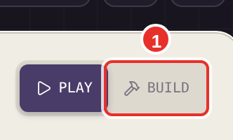

1. Click **BUILD** at the top of the screen. The editor opens. Click **PLAY** (to its left) at any time to play your game, and **BUILD** to come back.

## 2. Start a new game

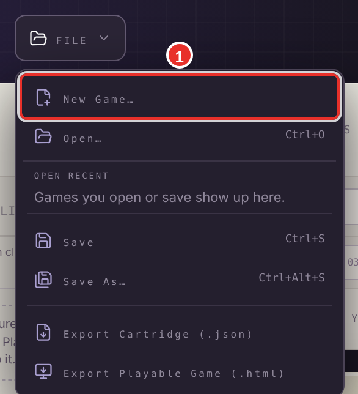

1. Click **FILE** at the top left, then **New Game…**.

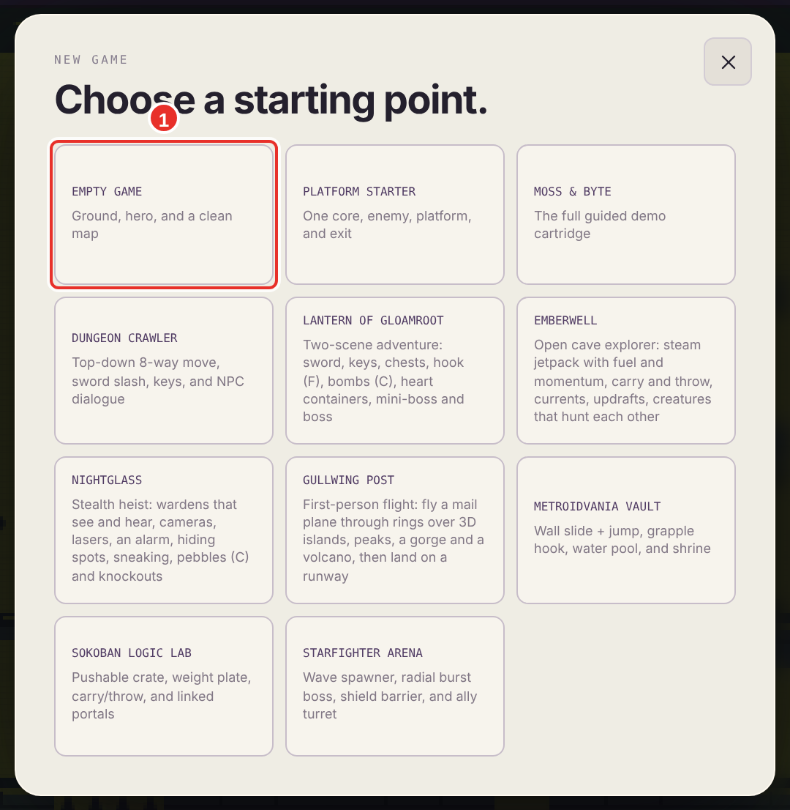

1. Click **EMPTY GAME**. You get one 320 × 240 scene with a ground strip and a hero. The other cards open the finished demo games; the tutorials ask you to open one of those for comparison.

## 3. The parts of the editor

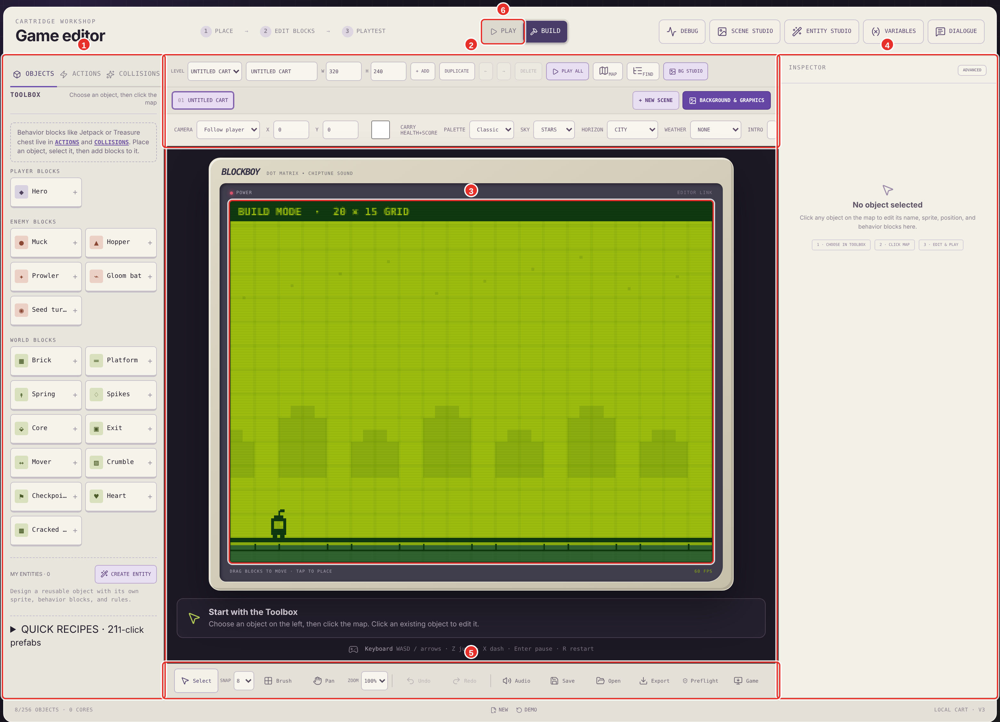

1. **Toolbox** (left). Three tabs: **OBJECTS** (things you place on the map), **ACTIONS** and **COLLISIONS** (behavior blocks you attach to a selected object).
2. **Scene bar** (top). The scene name, size, scene tabs and the scene's camera, palette, sky, weather and intro text.
3. **Map** (middle). Your scene. Click an object to select it, drag it to move it.
4. **Object Inspector** (right). Everything about the selected object: name, sprite, position, size, blocks and rules.
5. **Toolbar** (bottom). Select, Snap, Brush, Pan, Zoom, Undo, Redo and Save.
6. **PLAY / BUILD** switch.

## 4. Name and size a scene

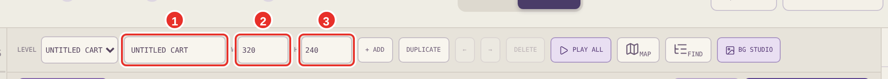

1. Click in the **scene name** box (the second box in the top row), select the old name and type the new one.
2. Click in **W** (width in pixels) and type the width. One screen is 320 wide.
3. Click in **H** (height in pixels) and type the height. One screen is 240 tall.

Press **Tab** or click somewhere else after typing a number so the editor takes it.

## 5. Scene settings: camera, palette, sky, weather and intro

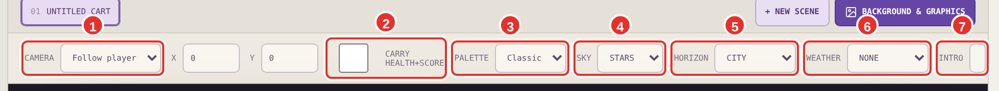

1. **CAMERA**: open the list and pick **Follow player** (scrolls with the hero), **Snap rooms** (one 320 × 240 room at a time) or **Fixed**.
2. **CARRY HEALTH+SCORE**: tick this box so the hero keeps hearts and score when arriving in this scene from another one.
3. **PALETTE**: the four colours this scene draws with. Your own palettes appear here after you make them (step 7).
4. **SKY**: the backdrop behind everything.
5. **HORIZON**: the silhouette layer (city, hills, none…).
6. **WEATHER**: particles such as fireflies, snow, rain or embers.
7. **INTRO**: the banner text shown when the scene starts. Click in the box and type.

If your window is narrow, the row scrolls sideways: scroll it with the trackpad or Shift + mouse wheel to reach WEATHER and INTRO.

## 6. Add a second scene and switch between scenes

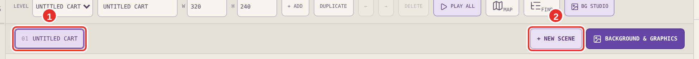

1. Each scene has a tab (**01 …**, **02 …**). Click a tab to edit that scene.
2. Click **+ NEW SCENE** to add a scene. It opens as the new current tab; name and size it as in step 4.

## 7. Make your own palette

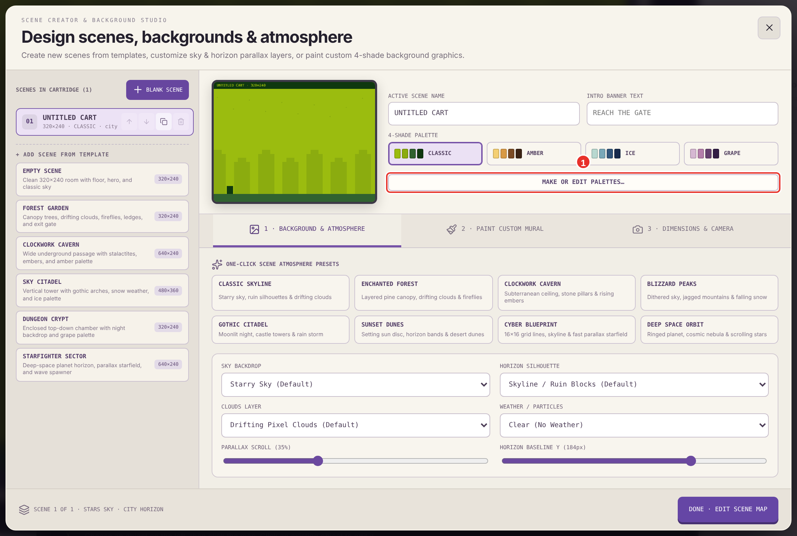

1. Click **SCENE STUDIO** at the top right of the editor, then click **MAKE OR EDIT PALETTES…**.

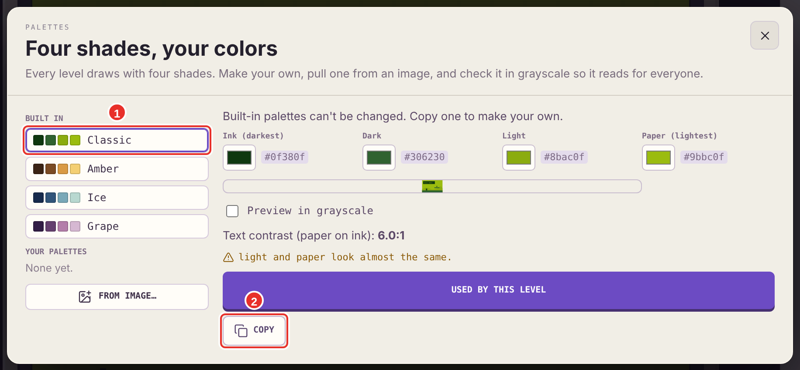

1. Under **BUILT IN**, click any palette (for example **Classic**).
2. Click **COPY**. A copy appears under **YOUR PALETTES** and is selected.

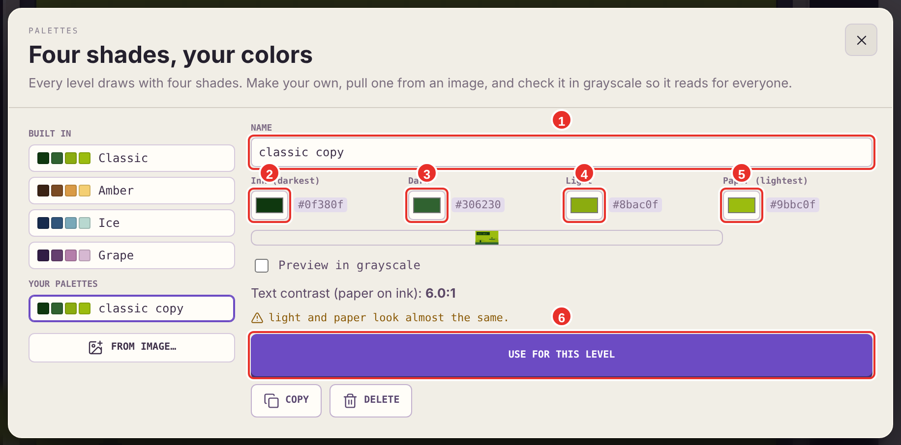

1. **NAME**: select the text and type the palette's name.
2. to 5. Click each colour square (**Ink**, **Dark**, **Light**, **Paper**). Your system colour picker opens. Type the hex code from the tutorial (for example `#1b2a24`) into its hex field and close the picker. On a Mac, the hex field is under the sliders tab (choose **RGB Sliders**); in Chrome it is the box under the colour area.
3. Click **USE FOR THIS LEVEL** to use the selected palette for the current scene.

Close the window with **×**, then click **DONE · EDIT SCENE MAP** to leave Scene Studio. You can also pick a palette for a scene later from the **PALETTE** list (step 5).

## 8. Place an object

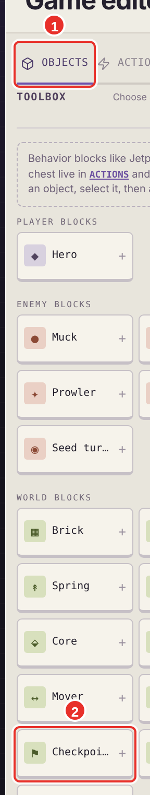

1. Click the **OBJECTS** tab in the Toolbox.
2. Click the kind of object you want, for example **Checkpoint**.

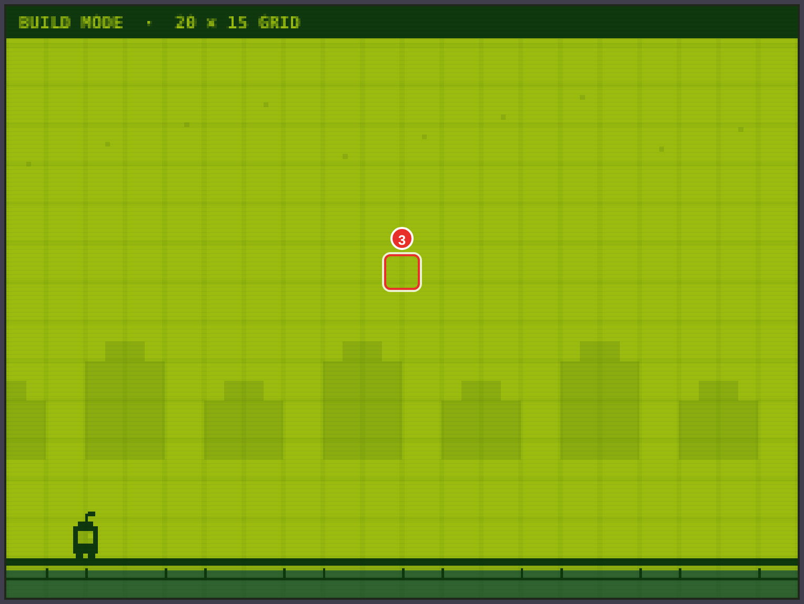

3. Click the map where the object should go. It does not have to be exact; you type the exact position next (step 9).

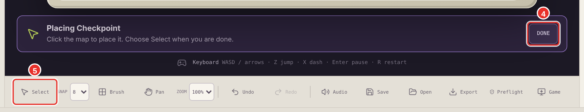

4. The editor stays in placing mode, so **every further click on the map places another one**. When you have placed what you need, click **DONE** in the bar under the map (or the **Select** tool, or press **Esc**).

If you placed one too many, click **Undo** in the toolbar or press **Ctrl+Z** (**⌘Z** on a Mac).

## 9. Name an object and type its position and size

Click the object on the map to select it (or find it with **FIND**, step 17). The Object Inspector shows it.

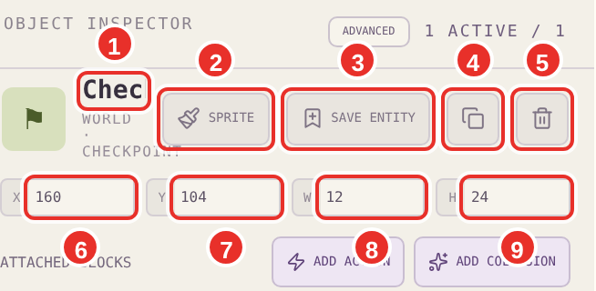

1. **Name**: click the name, select it and type the new name. The tutorials give every object a name so you can find it again.
2. **SPRITE** opens the sprite editor (step 15).
3. **SAVE ENTITY** saves this object, blocks and sprite included, to your Toolbox (step 16).
4. **Duplicate** makes a copy next to it.
5. **Delete** removes it (the **Delete** key does the same).
6. to 9. **X**, **Y**, **W**, **H**: click each box, select the number and type the new one. X and Y are the top-left corner in pixels, W and H the width and height.

When a tutorial writes `x 64, y 120, w 12 × h 16` (or `64, 120, 12 × 16`), type 64 in X, 120 in Y, 12 in W and 16 in H.

## 10. Block cards: turn off, reorder, remove and change settings

Each block attached to an object is a card in the inspector under **ATTACHED BLOCKS**.

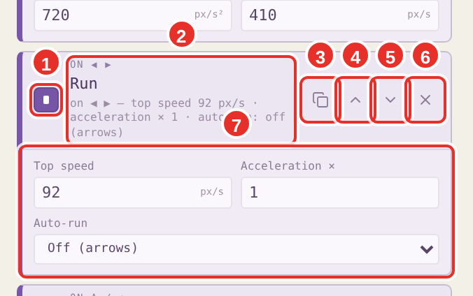

1. **On/off switch.** Click the coloured square to switch the block off (it goes grey) or back on. A switched-off block does nothing until a rule or chest switches it on.
2. The block's name and a one-line summary of its settings.
3. **Copy** the block (you can paste it on another object).
4. **Move up** and 5. **Move down**. Blocks run top to bottom; when a tutorial says "move it to the top", click the up arrow until it is first.
5. **×** removes the block from the object. Tutorials say "remove Gravity" for this.
6. **Settings.** Type numbers into the boxes and pick choices from the lists. Tutorials write these as `Setting = value`, using the names shown here (for example `Top speed = 88`). A small arrow button appears next to the copy button once you change a setting; it resets the block to its defaults.

## 11. Add a block

Blocks come in two groups: **ACTION** blocks do something every frame or when a key is pressed (move, shoot, wander…), **COLLISION** blocks react when something touches the object (damage, dialogue, pickups…). The tutorials say which group each block is in.

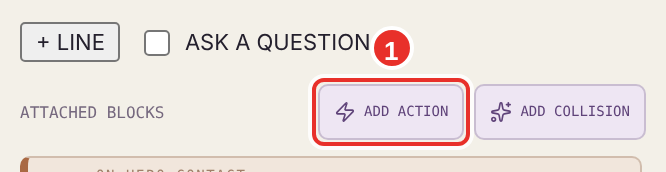

1. With the object selected, click **ADD ACTION** (or **ADD COLLISION**) in the inspector.

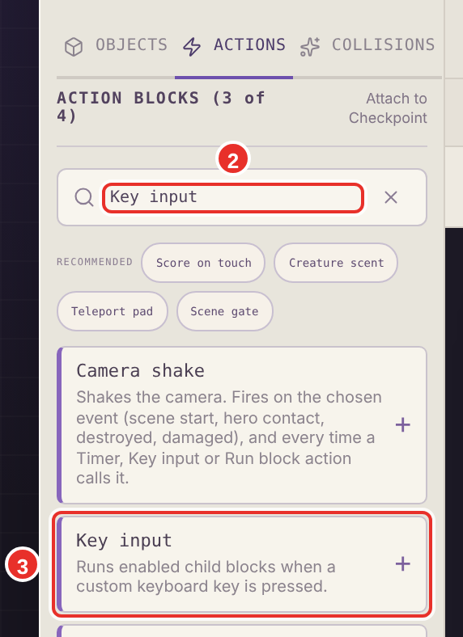

2. The Toolbox switches to that tab. Click the **search box** and type part of the block name.
3. Click the block's card (or the **+** on it). It is added at the bottom of the object's blocks.

The same steps with ADD COLLISION, searching for "Dialogue":

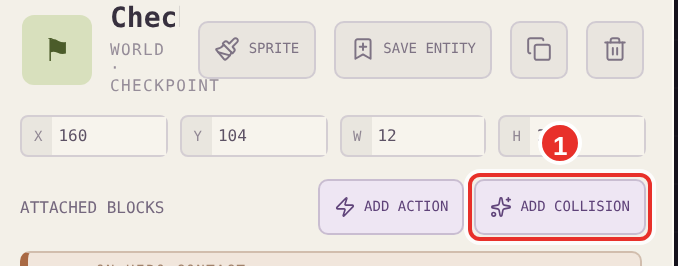

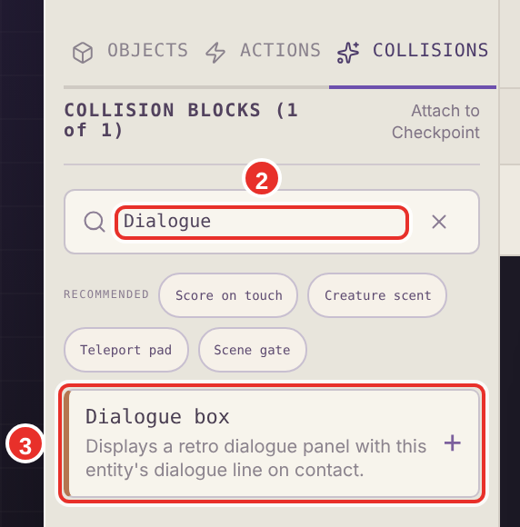

If the block you want is not in the list, look at the bottom of the Toolbox under **NOT FOR …** (blocks that usually suit a different kind of object) and **ALSO IN COLLISIONS / ACTIONS** (the block is in the other tab: click **SWITCH TAB**).

## 12. Dialogue text

When an object has a **Dialogue box** block, text boxes appear at the top of the inspector.

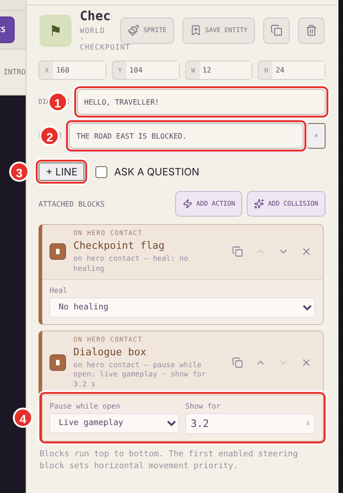

1. Click the **DIALOGUE** box and type the first line.
2. Each extra line has its own box (**LINE 2**, **LINE 3**…). The **×** beside a line removes it.
3. Click **+ LINE** to add another line box.
4. The Dialogue box block's settings: **Pause while open** (pause the game or keep playing) and **Show for** (seconds per line).

## 13. Blocks that run other blocks (Key input, Timer)

Some blocks hold other blocks inside them. **Key input** runs its blocks when a key is pressed; **Timer** runs them on a timer.

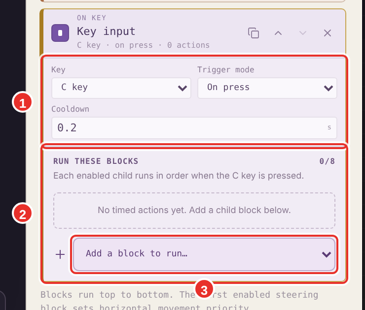

1. The block's own settings, for example **Key** (which keyboard key) and **Trigger mode**.
2. **RUN THESE BLOCKS** lists the blocks inside it. Each has its own on/off switch, arrows and **×**, like a normal card.
3. Open **Add a block to run…** and pick a block to put inside. Its settings appear in its card.

## 14. Rules (WHEN … DO …)

Rules make things happen on events, for example "when the game starts, hide me". Rules are in the inspector's advanced view.

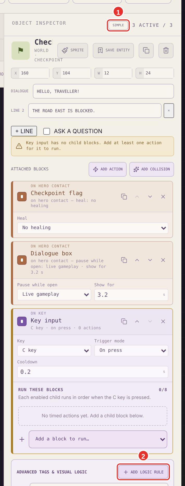

1. Click **ADVANCED** at the top right of the inspector. It changes to **SIMPLE**; click that to go back to the normal view. (In the normal view, an object with rules shows "1 LOGIC RULE ATTACHED · EDIT LOGIC"; clicking that also opens the advanced view.)
2. Scroll down to **ADVANCED TAGS & VISUAL LOGIC** and click **ADD LOGIC RULE**.

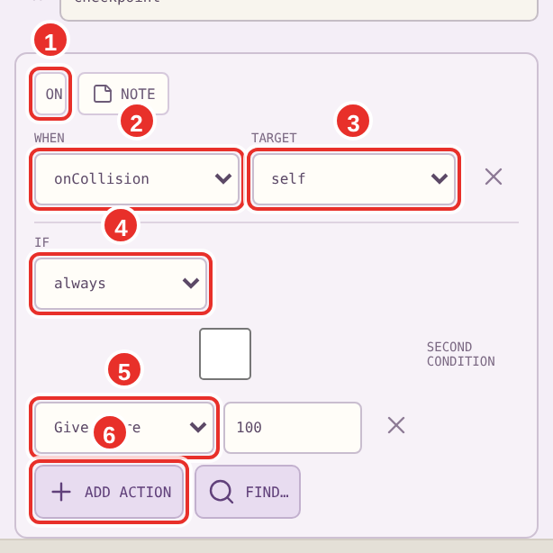

1. **ON**: the rule's on/off switch.
2. **WHEN**: the event, for example `onStart` (the scene starts), `onCollision` (the hero touches it), `onDestroy`, `onState`.
3. **TARGET**: who the actions apply to, usually `self`.
4. **IF**: an extra condition; leave it at `always` unless the tutorial says otherwise. The list uses short names: `stateEquals` (this object's state is…), `otherTagEquals` (the thing touching it has the tag…), `heroNearby`, `healthBelow` and so on. When you pick one, a **VALUE** box appears beside it; type the state, tag or number there.
5. **DO**: the action list. Pick the action (for example **Show / hide**) and fill in the box beside it (for example **hide**). A new rule starts with "Give score 100"; change it to what the tutorial says.
6. **ADD ACTION** adds another action to the same rule.

Tutorials write rules on one line, for example `WHEN onStart · TARGET self · DO Show / hide (hide)`. That means: WHEN = onStart, TARGET = self, IF = always, first action = Show / hide, its value = hide.

## 15. Sprites: import or draw

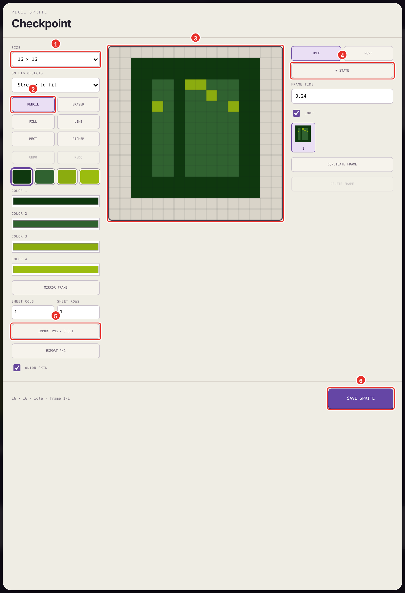

Click **SPRITE** in the inspector (step 9) to open the sprite editor.

1. **SIZE**: pick 16 × 16 (or the size the tutorial gives).
2. Drawing tools (**PENCIL**, **ERASER**, **FILL**, **LINE**, **RECT**, **PICKER**) and, under them, the four palette colours. Click a colour, then draw.
3. The drawing grid. Click or drag to paint pixels.
4. The animation tabs. **IDLE** is the standing animation. Click **+ STATE** to add another animation (for example `move`) and type its name.
5. **IMPORT PNG / SHEET** loads a picture into the current animation. Every tutorial comes with ready-made sprite files in its `sprites` folder: pick the animation tab, click IMPORT PNG / SHEET and choose the file with the same name (for example `sprites/wren/move.png`). A file with several frames side by side becomes several frames.
6. **SAVE SPRITE** saves and closes. Closing with **×** throws your changes away.

On the right, **FRAME TIME** sets the seconds per frame, **LOOP** repeats the animation, and **DUPLICATE FRAME** adds a frame to draw. For objects bigger than the sprite (a wall, water), set **ON BIG OBJECTS = Repeat as tiles** so the picture repeats instead of stretching.

## 16. Save an object as an entity and place copies

When several objects are the same (three bats, five signs), set one up completely, then save it as an entity.

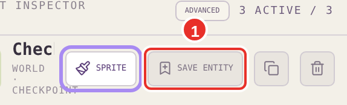

1. Select the finished object and click **SAVE ENTITY**.

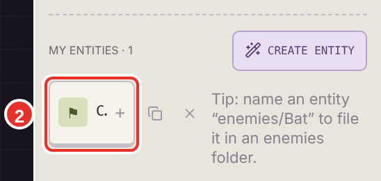

2. It appears in the Toolbox (OBJECTS tab) under **MY ENTITIES**. Click it, then click the map to place a copy with the same blocks and sprite. Give each copy its own name and position.

You can also copy and paste: select an object, press **Ctrl+C** then **Ctrl+V** (**⌘C**, **⌘V** on a Mac), and type the copy's new X and Y.

## 17. Find an object

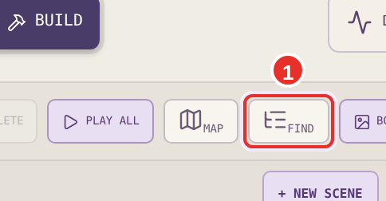

1. Click **FIND** in the scene bar (or press **/**).

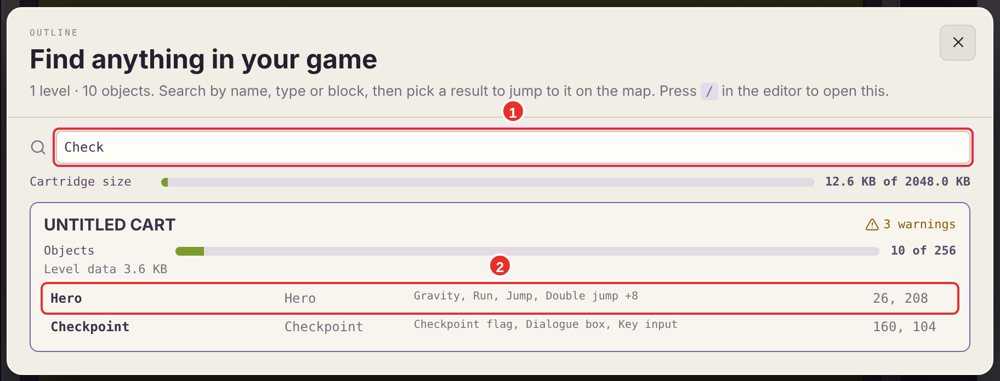

1. Type part of a name, a kind or a block name.
2. Click a result. The editor switches to its scene, scrolls the map to it and selects it.

## 18. Paint walls quickly with the Brush

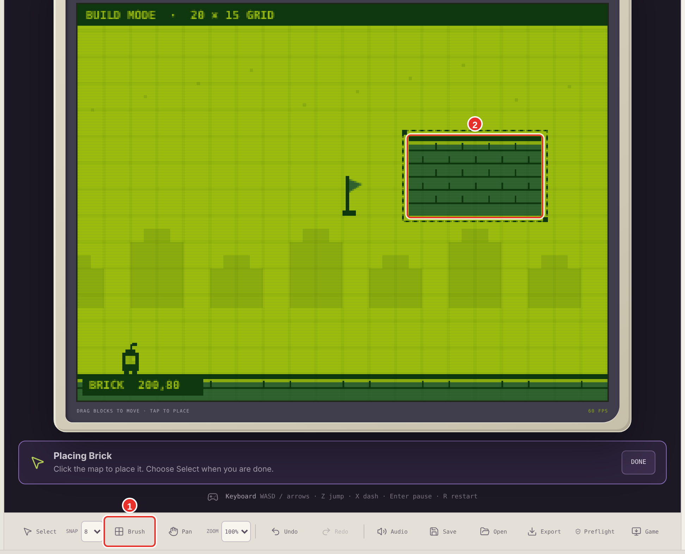

1. Click **Brush** in the toolbar, then click **Brick** (or **Platform**) in the Toolbox. The Brush only paints these two kinds.
2. Drag a rectangle on the map. One object fills the rectangle, rounded to the **SNAP** grid, and it is selected.
3. The Brush switches itself off after each rectangle, so click **Brush** again before you drag the next piece.

Then click each piece and fix its exact X, Y, W, H in the inspector. The Brush never paints in the top 16 px of a scene (the HUD strip), so a piece that starts at y = 0 must be typed in.

## 19. The toolbar

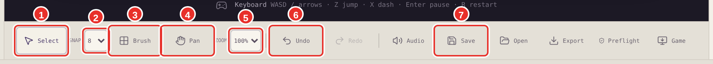

1. **Select**: click to select, drag to move.
2. **SNAP**: objects you drag snap to this grid (8 or 16 px). Typed positions are never snapped.
3. **Brush**: paint objects by dragging (step 18).
4. **Pan**: drag to scroll the map. Holding **Space** while dragging does the same with any tool.
5. **ZOOM**: make the map bigger or smaller.
6. **Undo** (Ctrl/⌘+Z) and **Redo** (Ctrl/⌘+Y).
7. **Save** (Ctrl/⌘+S).

## 20. Playtest

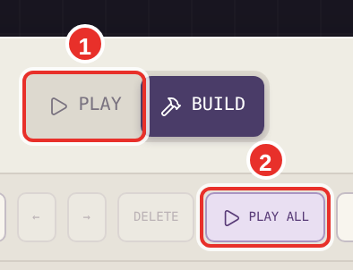

1. **PLAY** (or **Ctrl+Enter** / **⌘+Enter**) plays the scene you are editing.
2. **PLAY ALL** plays the game from its first scene.

In the game, **E** returns to the editor, **Enter** pauses and **R** restarts.

## 21. Save your work

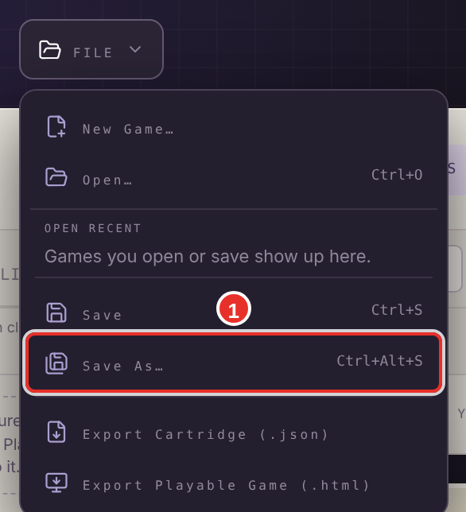

1. Click **FILE**, then **Save As…** the first time (afterwards **Save**, or Ctrl/⌘+S).

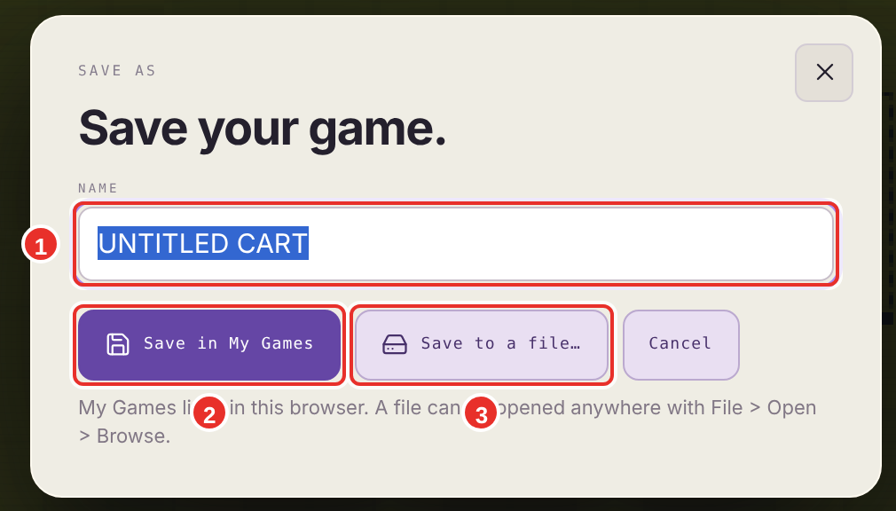

1. Type a name for your game.
2. **Save in My Games** keeps it in BlockBoy (open it again with FILE > Open…).
3. **Save to a file…** saves a `.json` file you can keep, back up or share.

Save after every part of a tutorial.
