# Nightglass

*A top-down stealth heist made with [BlockBoy Game Foundry](https://github.com/icakinser/Blockboy-Game-Foundry), a block-based game engine.* This repo holds the playable game, its cartridge, and a step-by-step tutorial that rebuilds it from an empty cartridge.

<p align="center">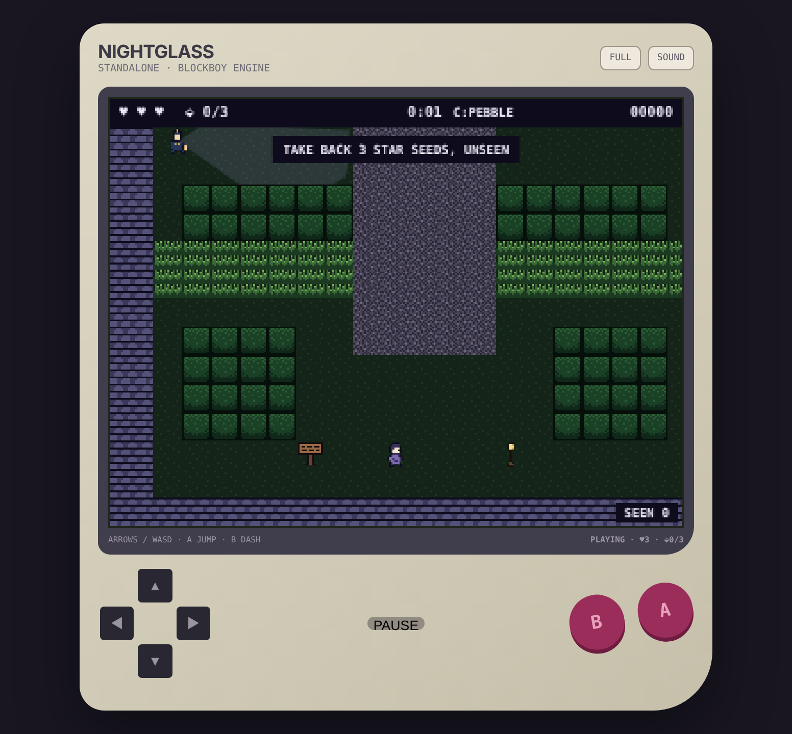</p>

**Nightglass** is a top-down stealth heist. Baron Vellum keeps three star seeds he took from the moth orchards. Moth slips into Vellum Glasshouse by night to take them back and leaves by the coal chute. The manor is one open scene of 3 × 3 screens; the seeds can be taken in any order, but the study needs the brass key from the kitchen.

1. **Front garden:** Warden Pell walks the front of the house. The gravel path crunches; the tall grass beside it hides you even while you move.
2. **Grand gallery:** Warden Quill loops the pillars and Warden Mott watches the study door. The boards in front of the door creak unless you sneak. Two reserve wardens wait in the barracks behind a portcullis that opens whenever the alarm rings.
3. **Glasshouse (seed 1):** glass walls stop you but not eyes. A camera sweeps the upper house and calls wardens to where it saw you; ferns hide you.
4. **Kitchen:** Cook Brindle paces in front of the tables; the brass key is behind them.
5. **Study (seed 2):** locked; Steward Ravel stands by the window. The fuse box here cuts the vault camera's power.
6. **Vault (seed 3):** a blinking laser across its door rings the alarm, and so does the camera inside unless the fuses are pulled. Warden Tull walks the antechamber.
7. **Coal yard:** the coal chute out (needs all three seeds), reached through the kitchen.

## Play it

- **In your browser:** download [`index.html`](index.html) and open it. The whole game is in that one file and needs no install or internet connection.
- **On the web:** turn on GitHub Pages for this repo (Settings > Pages > Deploy from branch `main`, folder `/`) and the game plays at `https://icakinser.github.io/blockboy-nightglass/`.
- **In BlockBoy:** download [`nightglass-cartridge.json`](nightglass-cartridge.json), then in the editor click **FILE > Open…** and **Browse this computer…** (or drop the file on the Open window) to see and edit every object, block and rule. The game also ships with BlockBoy itself under **FILE > New Game… > NIGHTGLASS**.

The controls are listed in [Controls in the finished game](#controls-in-the-finished-game) below.

## Screenshots

| | |
|---|---|
| 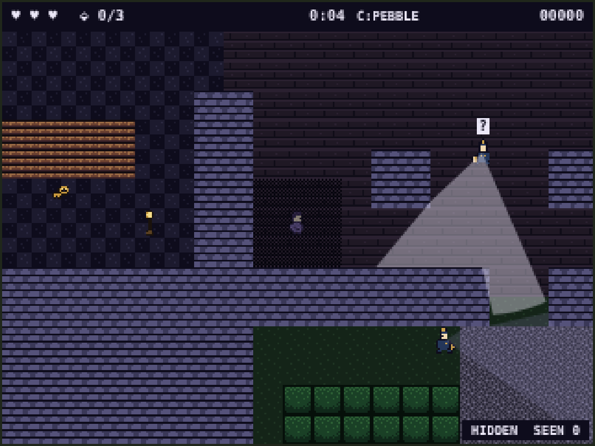<br>The gallery: throw a pebble to pull a guard away | 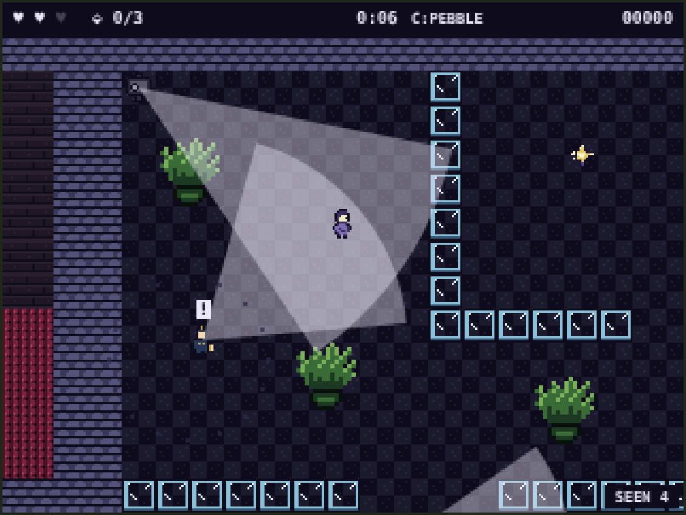<br>The glasshouse and its sweeping camera |
| 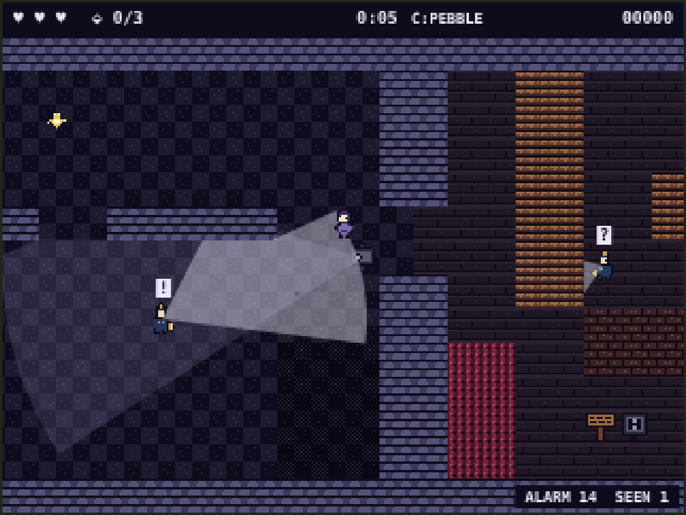<br>The vault: lasers and the alarm | 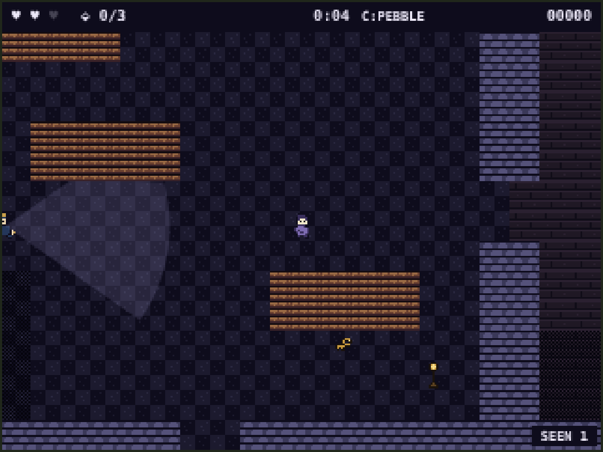<br>The kitchen and the brass key |
| 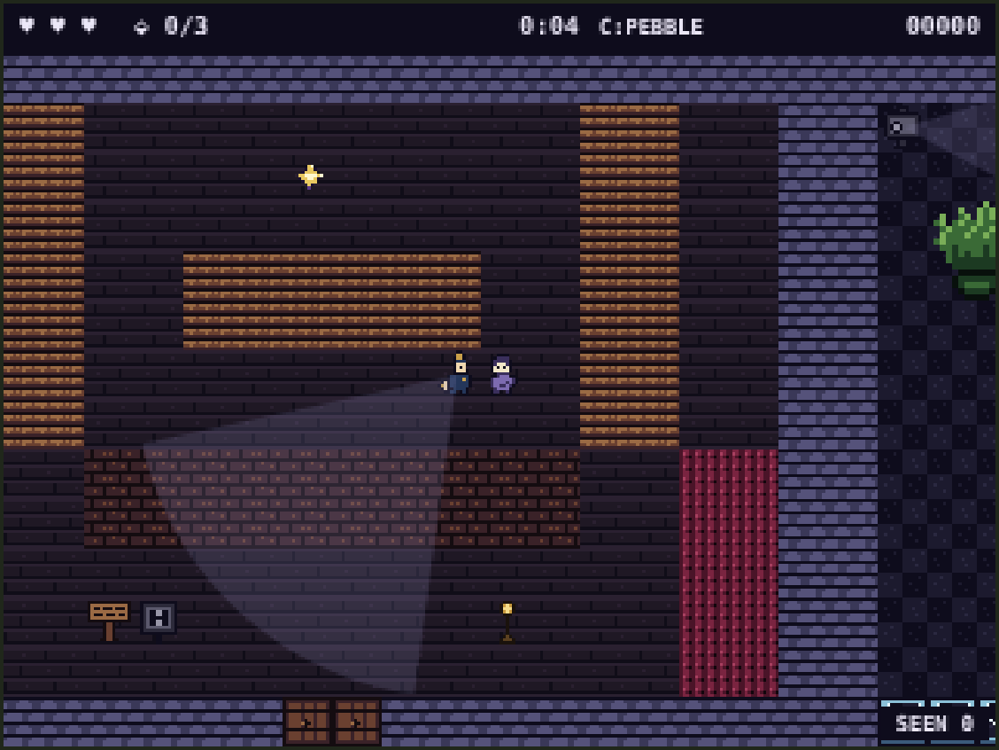<br>The study and the steward | |

## What's in this repo

| File | What it is |
| --- | --- |
| `index.html` | The standalone game, exported from BlockBoy |
| `nightglass-cartridge.json` | The game's cartridge, for loading into the BlockBoy editor |
| `screenshots/` | The gameplay pictures in this README |
| `EDITOR-BASICS.md` | Where to click in the BlockBoy editor, with annotated screenshots |
| `images/` | Editor screenshots used by the tutorial |
| `sprites/` | The game's pixel art as PNG files, ready to import |

## Tutorial: build Nightglass step by step

**Nightglass** is a top-down stealth heist. Baron Vellum keeps three star seeds he took from the moth orchards. Moth slips into Vellum Glasshouse by night to take them back and leaves by the coal chute. The manor is one open scene of 3 × 3 screens; the seeds can be taken in any order, but the study needs the brass key from the kitchen.

1. **Front garden:** Warden Pell walks the front of the house. The gravel path crunches; the tall grass beside it hides you even while you move.
2. **Grand gallery:** Warden Quill loops the pillars and Warden Mott watches the study door. The boards in front of the door creak unless you sneak. Two reserve wardens wait in the barracks behind a portcullis that opens whenever the alarm rings.
3. **Glasshouse (seed 1):** glass walls stop you but not eyes. A camera sweeps the upper house and calls wardens to where it saw you; ferns hide you.
4. **Kitchen:** Cook Brindle paces in front of the tables; the brass key is behind them.
5. **Study (seed 2):** locked; Steward Ravel stands by the window. The fuse box here cuts the vault camera's power.
6. **Vault (seed 3):** a blinking laser across its door rings the alarm, and so does the camera inside unless the fuses are pulled. Warden Tull walks the antechamber.
7. **Coal yard:** the coal chute out (needs all three seeds), reached through the kitchen.

This tutorial rebuilds the whole game from an empty cartridge in the BlockBoy editor, object by object, with every block setting and rule. Every step says exactly what to click, and every object has a picture of how it looks in the editor when it is done. The six stealth blocks are covered in depth in [the block reference](https://github.com/icakinser/Blockboy-Game-Foundry/blob/main/docs/BLOCK-REFERENCE.md#stealth).

**What you will learn:** a sneaking top-down hero, guards with sight cones, hearing and patrol routes, security cameras, hiding spots (shadow and cover), noisy floors, thrown pebbles as distractions, laser tripwires that blink, an alarm that opens the barracks, a fuse box rule that switches a camera off, keys and locked doors, collect-all-then-exit, floors drawn under everything, and glass that blocks bodies but not eyes.

**Time:** about 3 hours.

---

### Before you start

#### Learn the editor moves

If you have not used the BlockBoy editor before, read **[BlockBoy editor basics](EDITOR-BASICS.md)** first (10 minutes). It shows, with pictures, where to click for everything this tutorial asks you to do. The steps below link to the right section each time.

The moves you will repeat most:

| The tutorial says                            | You do                                                                                                                                                                        |
| -------------------------------------------- | ----------------------------------------------------------------------------------------------------------------------------------------------------------------------------- |
| **Place a Prowler**                          | Toolbox > **OBJECTS** tab > click **Prowler** > click the map > click **DONE** ([§8](EDITOR-BASICS.md#8-place-an-object))                                                     |
| **Name Warden Pell, at `338, 496, 12 × 16`** | In the inspector type the name, then X = 338, Y = 496, W = 12, H = 16 ([§9](EDITOR-BASICS.md#9-name-an-object-and-type-its-position-and-size))                                |
| **Remove Hazard**                            | Click the **×** on the Hazard card ([§10](EDITOR-BASICS.md#10-block-cards-turn-off-reorder-remove-and-change-settings))                                                       |
| **Add Hiding spot (Collisions)**             | **ADD COLLISION** > type "Hiding" in the search box > click **Hiding spot** ([§11](EDITOR-BASICS.md#11-add-a-block))                                                          |
| **`Sees up to = 88`**                        | In that block's card, type 88 in the **Sees up to** box, or pick the value from its list ([§10](EDITOR-BASICS.md#10-block-cards-turn-off-reorder-remove-and-change-settings)) |
| **Rule `WHEN onStart · TARGET self · DO …`** | **ADVANCED** > **ADD LOGIC RULE** > set WHEN, TARGET and the action ([§14](EDITOR-BASICS.md#14-rules-when--do-))                                                              |
| **Sprite `moth/idle.png`**                   | **SPRITE** > **IMPORT PNG / SHEET** > pick the file from this tutorial's `sprites` folder > **SAVE SPRITE** ([§15](EDITOR-BASICS.md#15-sprites-import-or-draw))               |
| **Copy it**                                  | Select the finished object, press **Ctrl+D** (**⌘D** on a Mac) to duplicate it, then type the copy's name and position                                                        |

"Actions" blocks are added with **ADD ACTION**, "Collisions" blocks with **ADD COLLISION**. Anything a step does not mention stays at its default.

#### Get the sprite files

The finished game's pixel art is in the [`sprites/nightglass`](sprites/nightglass) folder next to this tutorial, one folder per object and one PNG per animation. Download it (on GitHub: **Code > Download ZIP**, then unzip) so you can import the pictures instead of drawing them. Each PNG is a strip of frames side by side; IMPORT PNG / SHEET turns it into that many frames.

#### Keep the finished game open for comparison

Open a second BlockBoy window (or browser tab), click **BUILD**, then **FILE > New Game… > NIGHTGLASS**. Play it once with **PLAY**. Click any object to see its blocks, or press **/** and type its name.

Then, in your working window, start your own game (Part 1) and save it under its own name with **FILE > Save As…** ([§21](EDITOR-BASICS.md#21-save-your-work)). Save again after every part.

#### Two things that matter in this game

- **Coordinates.** Every object gives `x, y, w × h` in pixels: the top-left corner, then the width and height. The manor is a **16 px tile grid**, so most numbers are multiples of 16. Type the numbers and the object jumps there.
- **Draw order is object order.** Objects you place first are drawn first, underneath the rest. That is why this tutorial builds the floors first, then the hiding spots and noisy floors, and only then the walls and the people. If you forget a floor, place it and it will draw on top; delete it, finish the rest, and add floors in a new game next time.

#### Controls in the finished game

| Key                            | Does                             |
| ------------------------------ | -------------------------------- |
| Arrows / WASD                  | Walk (heard by wardens)          |
| Hold X (B)                     | Sneak: slow and silent           |
| C                              | Throw a pebble ahead (8 of them) |
| Walk into a warden from behind | Knock him out for 14 seconds     |
| Enter                          | Pause                            |

---

### Part 1: Set up the scene


The picture shows the scene bar of the finished game. Make yours match.

#### 1.1 Start an empty game

1. Click **BUILD** (top of the screen).
2. Click **FILE > New Game…**, then **EMPTY GAME** ([§2](EDITOR-BASICS.md#2-start-a-new-game)).
3. Click the long ground strip along the bottom of the map and press **Delete** (or click the bin at the top of the inspector). A top-down game has no ground.

#### 1.2 Name and size the scene

([§4](EDITOR-BASICS.md#4-name-and-size-a-scene), [§5](EDITOR-BASICS.md#5-scene-settings-camera-palette-sky-weather-and-intro))

1. Click the **scene name** box, select `UNTITLED CART` and type **VELLUM GLASSHOUSE**.
2. **W** = **960**, **H** = **720**. Press **Tab**. That is 3 × 3 screens (60 × 45 tiles).
3. **CAMERA** = **Follow player**.
4. **INTRO** = `TAKE BACK 3 STAR SEEDS, UNSEEN`.

#### 1.3 Make the palette

([§7](EDITOR-BASICS.md#7-make-your-own-palette))

1. Click **SCENE STUDIO** (top right of the editor), then **MAKE OR EDIT PALETTES…**.
2. Under BUILT IN click **Classic**, then **COPY**.
3. **NAME** = **Nightglass**. Click each colour square and type the hex code:

   | Shade         | Nightglass |
   | ------------- | ---------- |
   | Ink (darkest) | `#0e0c1c`  |
   | Dark          | `#2c2a48`  |
   | Light         | `#8f8cc0`  |
   | Paper         | `#ece8f8`  |

4. Click **Nightglass** under YOUR PALETTES, then **USE FOR THIS LEVEL**. Close the window with **×** and click **DONE · EDIT SCENE MAP**.

#### 1.4 The rooms

One screen each:

|                  | x 0 to 320 | x 320 to 640         | x 640 to 960     |
| ---------------- | ---------- | -------------------- | ---------------- |
| **y 0 to 240**   | Vault      | Study (locked)       | Upper glasshouse |
| **y 240 to 480** | Kitchen    | Grand gallery        | Lower glasshouse |
| **y 480 to 720** | Coal yard  | Front garden (start) | East lawn        |

---

### Part 2: Floors first

Nine floor pieces, one per room. Each is a **Spikes** object exactly one screen big with its Hazard block removed, so it has no blocks at all: just a picture you walk over.

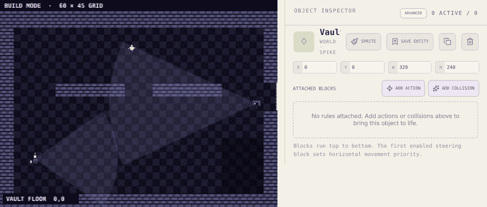

1. Place a **Spikes**. Name it **Vault floor**, at `0, 0, 320 × 240`.
2. Click **×** on **Hazard**.
3. **SPRITE** > import `sprites/nightglass/vault-floor/idle.png` (checker tiles) > open **ON BIG OBJECTS** and choose **Repeat as tiles** > **SAVE SPRITE**.
4. Copy it with **Ctrl+D** for the other checker floors, typing each name and position (W and H stay 320 × 240):

   | Name                   | x   | y   |
   | ---------------------- | --- | --- |
   | Upper glasshouse floor | 640 | 0   |
   | Kitchen floor          | 0   | 240 |
   | Lower glasshouse floor | 640 | 240 |

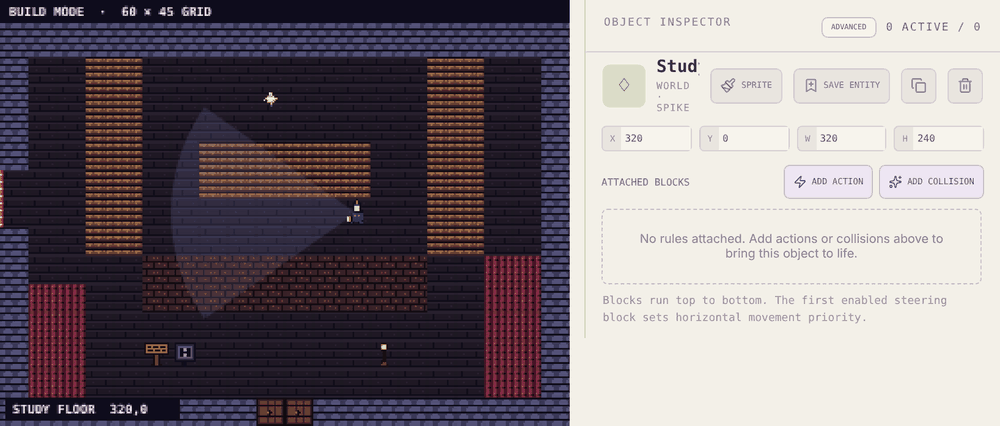

5. Copy once more, name **Study floor**, at `320, 0`. Open its **SPRITE**, import `study-floor/idle.png` (floorboards) over the old picture, **SAVE SPRITE**.
6. Copy the study floor: **Gallery floor** at `320, 240`.

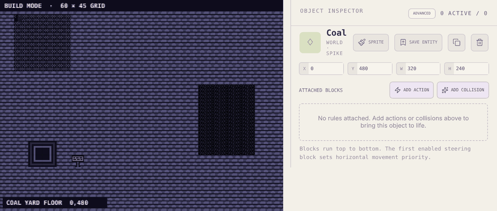

7. Copy again: **Coal yard floor** at `0, 480`, sprite `coal-yard-floor/idle.png` (flagstones).

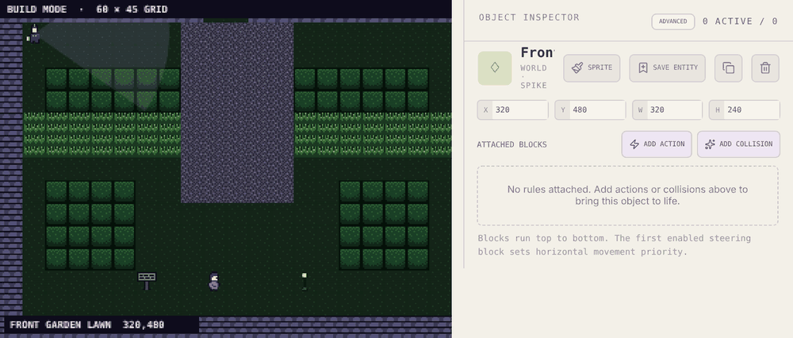

8. Copy again: **Front garden lawn** at `320, 480`, sprite `front-garden-lawn/idle.png` (lawn).
9. Copy the lawn: **East lawn** at `640, 480`.

> **Check:** the whole map is covered by nine tiled floors: checker, boards, checker on top, checker, boards, checker in the middle, flagstones and two lawns at the bottom.

---

### Part 3: Moth and the world settings

#### 3.1 Moth

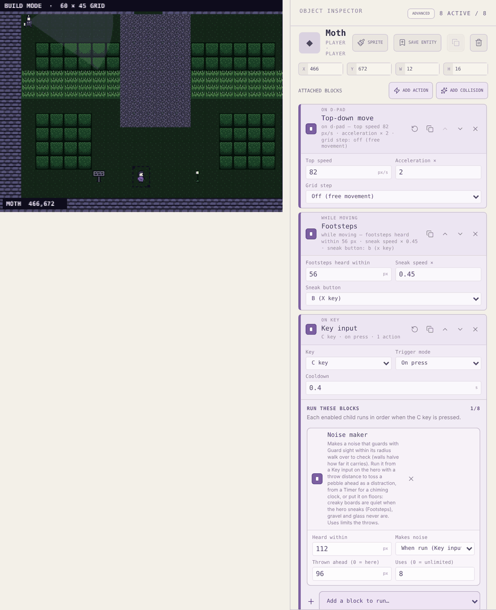

1. Click the hero. Name it **Moth**, at `466, 672, 12 × 16`.
2. Click **×** on **Gravity, Run, Jump, Double jump, Dash, Stomp attack, Dash attack**.
3. **ADD ACTION** > search "Top-down" > **Top-down move**. Click its **up arrow** until it is the first card. Set `Top speed = 82`, `Acceleration × = 2`, `Grid step = Off (free movement)`.
4. **ADD ACTION** > search "Foot" > **Footsteps**. Leave `Footsteps heard within = 56`, `Sneak speed × = 0.45`, `Sneak button = B (X key)`. Walking is now heard by wardens within 56 px; holding X sneaks slowly and silently.
5. The pebbles ([§13](EDITOR-BASICS.md#13-blocks-that-run-other-blocks-key-input-timer)):
   1. **ADD ACTION** > search "Key" > **Key input**. Set `Key = C key`, `Trigger mode = On press`, `Cooldown = 0.4`.
   2. In its **RUN THESE BLOCKS** area open **Add a block to run…** and pick **Noise maker**.
   3. In the Noise maker card set `Heard within = 112`, `Makes noise = When run (Key input, Timer, rule)`, `Thrown ahead (0 = here) = 96`, `Uses (0 = unlimited) = 8`. The HUD shows `C:PEBBLE` and how many are left.
6. On the **Damage + respawn** card set `Max hearts = 3`, `Invulnerable after hit = 1.5`, `Knockback = 0`. Keep **Heart collector, Core collector, Exit reader, Checkpoint reader**.
7. The tag: click **ADVANCED**, scroll down to **TAGS** (under ADD LOGIC RULE). It already says `player`; click at the end and type `, thief` so it reads `player, thief`. Click **SIMPLE**. The fuse box rule checks for this tag.
8. **SPRITE** (16 × 16):
   - **IDLE**: import `moth/idle.png`.
   - **+ STATE** `move`, import `moth/move.png`, **FRAME TIME = 0.14**.
   - **+ STATE** `sneak`, import `moth/sneak.png` (crouched), **FRAME TIME = 0.14**. Footsteps plays `sneak` by itself while the sneak button is held.
   - **SAVE SPRITE**.

#### 3.2 World settings

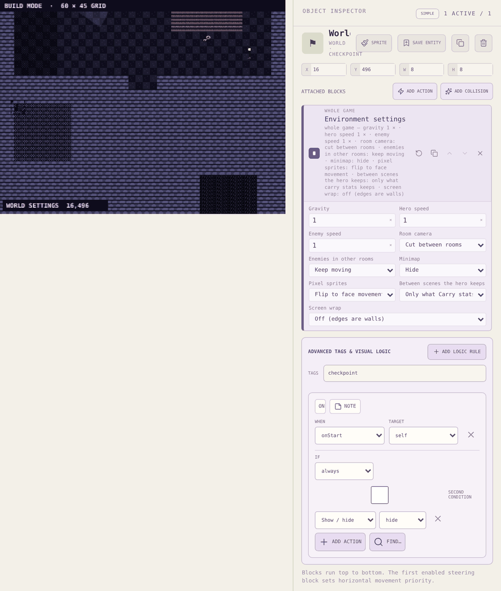

1. Place a **Checkpoint**. Name **World settings**, at `16, 496, 8 × 8`.
2. **×** on **Checkpoint flag**.
3. **ADD ACTION** > search "Environment" > **Environment settings**. Set `Minimap = Hide` and `Pixel sprites = Flip to face movement`.
4. Rule ([§14](EDITOR-BASICS.md#14-rules-when--do-)): **ADVANCED** > **ADD LOGIC RULE** > **WHEN** `onStart`, **TARGET** `self`, **IF** `always`, action **Show / hide** `hide`. Click **SIMPLE**.

> **Check:** click **PLAY**. Moth walks in 8 directions over the floors and the camera follows. Press **E** to come back.

---

### Part 4: Noisy floors and hiding spots

These go **before the walls and the people**, so they draw under them. All are **Spikes** with the Hazard block removed.

#### 4.1 Noisy floors (Noise maker)

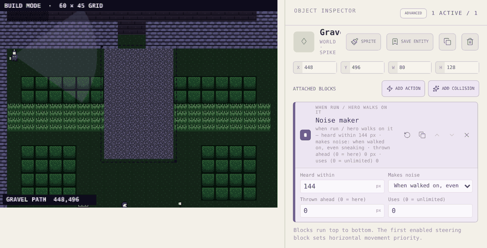

1. Place a **Spikes**. Name **Gravel path**, at `448, 496, 80 × 128`. **×** on **Hazard**.
2. **ADD ACTION** > search "Noise" > **Noise maker**. Set `Heard within = 144`, `Makes noise = When walked on, even sneaking`. Leave `Thrown ahead = 0`, `Uses = 0`. Gravel always crunches.
3. **SPRITE** > import `gravel-path/idle.png`, **ON BIG OBJECTS = Repeat as tiles** > **SAVE SPRITE**.

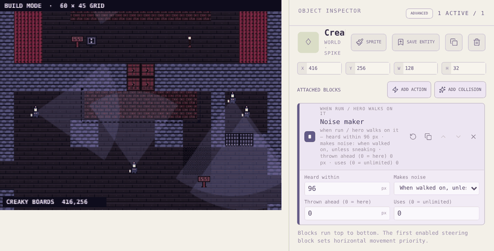

4. Place a **Spikes**. Name **Creaky boards**, at `416, 256, 128 × 32`. **×** on **Hazard**.
5. **ADD ACTION** > **Noise maker**: leave `Heard within = 96`, set `Makes noise = When walked on, unless sneaking`. Boards are quiet if Moth sneaks.
6. **SPRITE** > import `creaky-boards/idle.png`, **Repeat as tiles** > **SAVE SPRITE**.

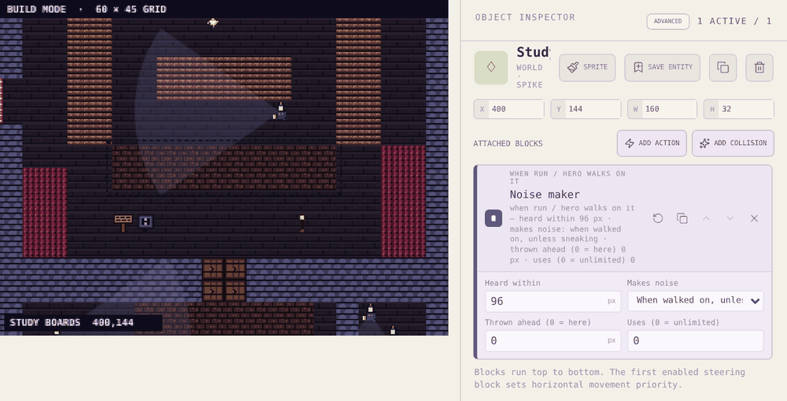

7. **Ctrl+D** on the creaky boards: **Study boards** at `400, 144, 160 × 32`.

#### 4.2 Hiding spots

A **Hiding spot** of kind **Shadow** hides Moth only while standing still; **Cover** hides even while moving. Leave `Moving in shadow, seen within = 28` everywhere.

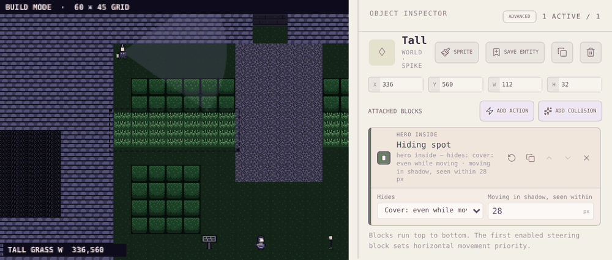

1. Place a **Spikes**. Name **Tall grass W**, at `336, 560, 112 × 32`. **×** on **Hazard**.
2. **ADD COLLISION** > search "Hiding" > **Hiding spot**: `Hides = Cover: even while moving`.
3. **SPRITE** > import `tall-grass-w/idle.png`, **Repeat as tiles** > **SAVE SPRITE**.
4. **Ctrl+D** for **Tall grass E** at `528, 560, 112 × 32` and **Lawn grass** at `720, 512, 32 × 176` (shown below).

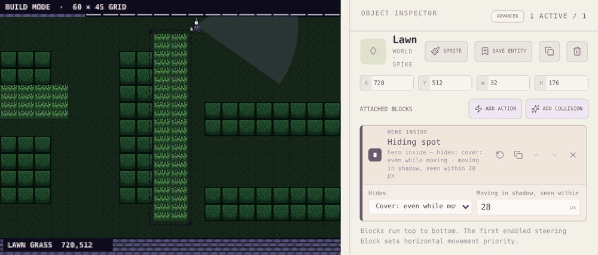

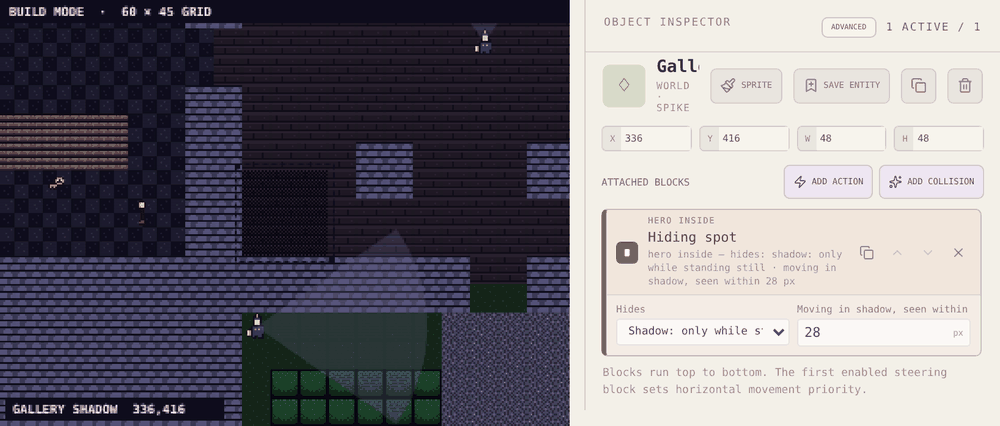

5. Place a **Spikes**. Name **Gallery shadow**, at `336, 416, 48 × 48`. **×** on **Hazard**.
6. **ADD COLLISION** > **Hiding spot**: leave `Hides = Shadow: only while standing still`.
7. **SPRITE** > import `gallery-shadow/idle.png` (a dark hatch), **Repeat as tiles** > **SAVE SPRITE**.
8. **Ctrl+D** for the other shadows:

   | Name               | x, y     | w × h   |
   | ------------------ | -------- | ------- |
   | Barracks shadow    | 528, 320 | 32 × 32 |
   | Pantry shadow      | 16, 384  | 48 × 80 |
   | Yard shadow        | 16, 496  | 64 × 64 |
   | Antechamber shadow | 256, 160 | 48 × 64 |

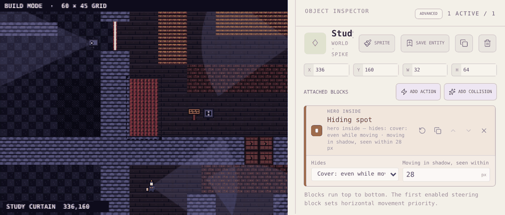

9. Copy **Tall grass W** (it is already Cover): **Study curtain** at `336, 160, 32 × 64`. Import `study-curtain/idle.png` (velvet) as its sprite.
10. **Ctrl+D** on the curtain: **Window curtain** at `592, 144, 32 × 80`.

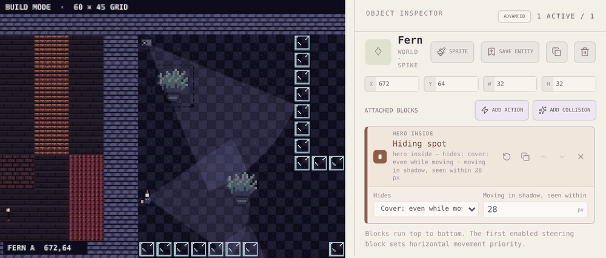

11. Copy **Tall grass W** once more: **Fern A** at `672, 64, 32 × 32`. Import `fern-a/idle.png` (a potted fern) and set **ON BIG OBJECTS = Stretch to fit**, so the one picture fills the whole 32 × 32.
12. **Ctrl+D** on Fern A for the other ferns, all `32 × 32`:

    | Name   | x, y     |
    | ------ | -------- |
    | Fern B | 736, 160 |
    | Fern C | 848, 176 |
    | Fern D | 688, 288 |
    | Fern E | 880, 304 |
    | Fern F | 768, 384 |

> **Check:** play. Walking in grass, the HUD box says HIDDEN; in a shadow it only says HIDDEN while Moth stands still.

---

### Part 5: The house

#### 5.1 The map

The map below is the template's exact layout. Each character is one 16 px tile at `x = 16 × column`, `y = 16 × row`:

- `#` **masonry**: 34 pieces named Wall 1 to Wall 34
- `f` **furniture**: tables, the desk, shelves (Furniture 1 to 6)
- `h` **hedge** (Hedge 1 to 7)
- `c` **coal heap** (Coal heap 1)
- `g` **glass** (Glass 1 to 5), tagged `glass`
- `.` floor

```text
          11111111112222222222333333333344444444445555555555
012345678901234567890123456789012345678901234567890123456789
############################################################  0
############################################################  1
#..................##..ff..........ff..##.........g........#  2
#..................##..ff..........ff..##.........g........#  3
#..................##..ff..........ff..##.........g........#  4
#..................##..ff..ffffff..ff..##.........g........#  5
#...#####..#####.......ff..ffffff..ff..##.........g........#  6
#......................ff..........ff..##.........g........#  7
#..................##..ff..........ff..##.........g........#  8
#..................##..................##.........gggggg...#  9
#..................##..................##..................# 10
#..................##..................##..................# 11
#..................##..................##..................# 12
#..................##..................##..................# 13
#############################..##########ggggggg....ggggggg# 14
#############################..##########..................# 15
#.fffff............##..............#...##..................# 16
#..................##..............#...##..................# 17
#..................##....##....##..#...##..................# 18
#...fffff..........##....##....##..#..###..................# 19
#...fffff..........##..................##..................# 20
#......................................##..................# 21
#..........................................................# 22
#..................##......................................# 23
#...........fffff..##..................##..................# 24
#...........fffff..##....##....##......##..................# 25
#..................##....##....##......##..................# 26
#..................##..................##..................# 27
#..................##..................##..................# 28
#########..##################..##########gggggggggggggggggg# 29
#########..##################..##########gggggggggggggggggg# 30
#..................##......................................# 31
#..................##......................................# 32
#..................##.hhhhhh.....hhhhhh....hh..............# 33
#..................##.hhhhhh.....hhhhhh....hh..............# 34
#..................##......................hh..............# 35
#.............cccc.##......................hh...hhhhhhhh...# 36
#.............cccc.##......................hh...hhhhhhhh...# 37
#.............cccc.##.hhhh.........hhhh....hh..............# 38
#.............cccc.##.hhhh.........hhhh....hh..............# 39
#.............cccc.##.hhhh.........hhhh....hh..............# 40
#..................##.hhhh.........hhhh....hh...hhhhhhhh...# 41
#..................##...........................hhhhhhhh...# 42
#..................##......................................# 43
############################################################ 44
```

Gaps to keep open: the study door at columns 29 to 30, row 14 (Part 9 puts the locked door there); the kitchen-to-coal-yard passage at columns 9 to 10, rows 29 to 30; the gallery-to-garden passage at columns 29 to 30, rows 29 to 30; the opening in the glass at columns 48 to 51, row 14.

[Appendix A](#appendix-a-house-pieces) lists every piece with its exact name, x, y, w and h.

#### 5.2 Masonry

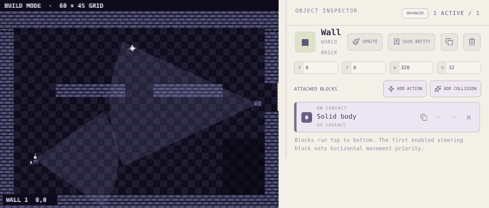

1. Place a **Brick**. Name **Wall 1**, at `0, 0, 320 × 32`. Keep **Solid body**.
2. **SPRITE** > import `coal-yard-floor/idle.png` (the same stone as the yard flagstones), **ON BIG OBJECTS = Repeat as tiles** > **SAVE SPRITE**.
3. **Ctrl+D** and type the next row of the Wall table in Appendix A. Repeat for all 34 pieces.

#### 5.3 Furniture, hedges and coal

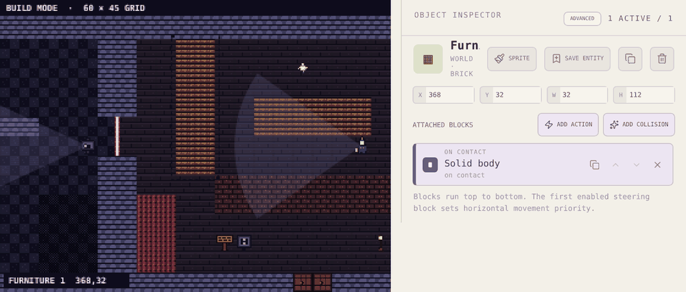

1. Copy **Wall 1**, name **Furniture 1**, type its numbers from the appendix and import `furniture-1/idle.png` (wood) as its sprite. Then **Ctrl+D** it for Furniture 2 to 6.

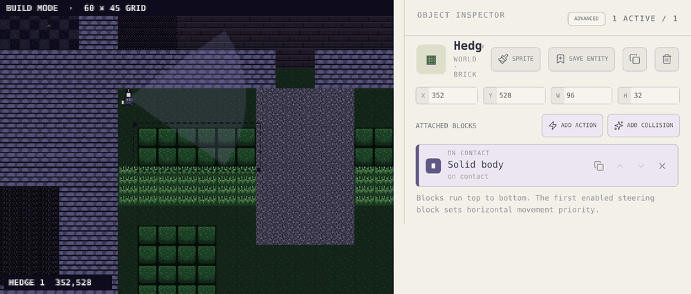

2. The same for **Hedge 1** to **Hedge 7** with `hedge-1/idle.png`.

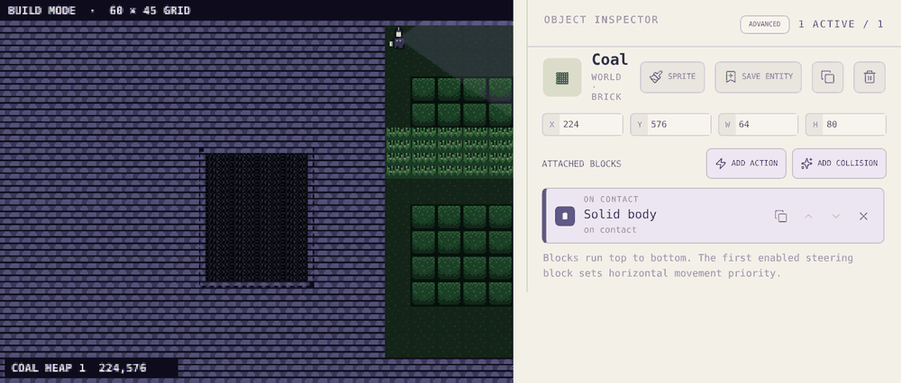

3. And **Coal heap 1** with `coal-heap-1/idle.png`.

#### 5.4 Glass

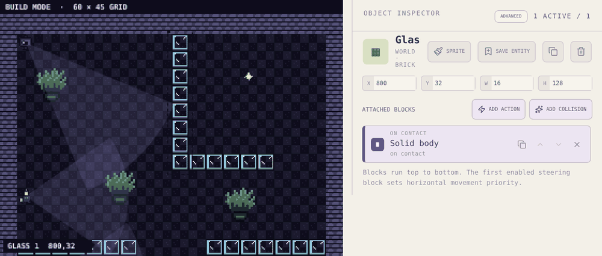

1. Copy **Wall 1**, name **Glass 1**, type its numbers from the appendix and import `glass-1/idle.png` as its sprite.
2. Click **ADVANCED**, find **TAGS** and change `brick` to `brick, glass`. Click **SIMPLE**.
3. **Ctrl+D** it for Glass 2 to 5 (copies keep the tag).

Guard sight and Security cameras look straight through objects tagged `glass`, but Moth cannot walk through them. That is what makes the glasshouse tense: they can see you from the next room.

Faster but plainer: use the **Brush** ([§18](EDITOR-BASICS.md#18-paint-walls-quickly-with-the-brush)) with **Brick** and **SNAP = 16** to drag each piece, clicking **Brush** again before each rectangle, then give each piece its sprite. Make each rectangle no bigger than one screen (20 × 15 tiles).

> **Check:** play. Moth is boxed in by the house walls; the glass in the glasshouse blocks Moth but you can see through it.

---

### Part 6: Wardens

Every warden is a **Prowler** `12 × 16` with all its starter blocks removed and one **Guard sight** block. Build Warden Pell fully, then copy him for the others and change only what the table says.

#### 6.1 Warden Pell, the first warden

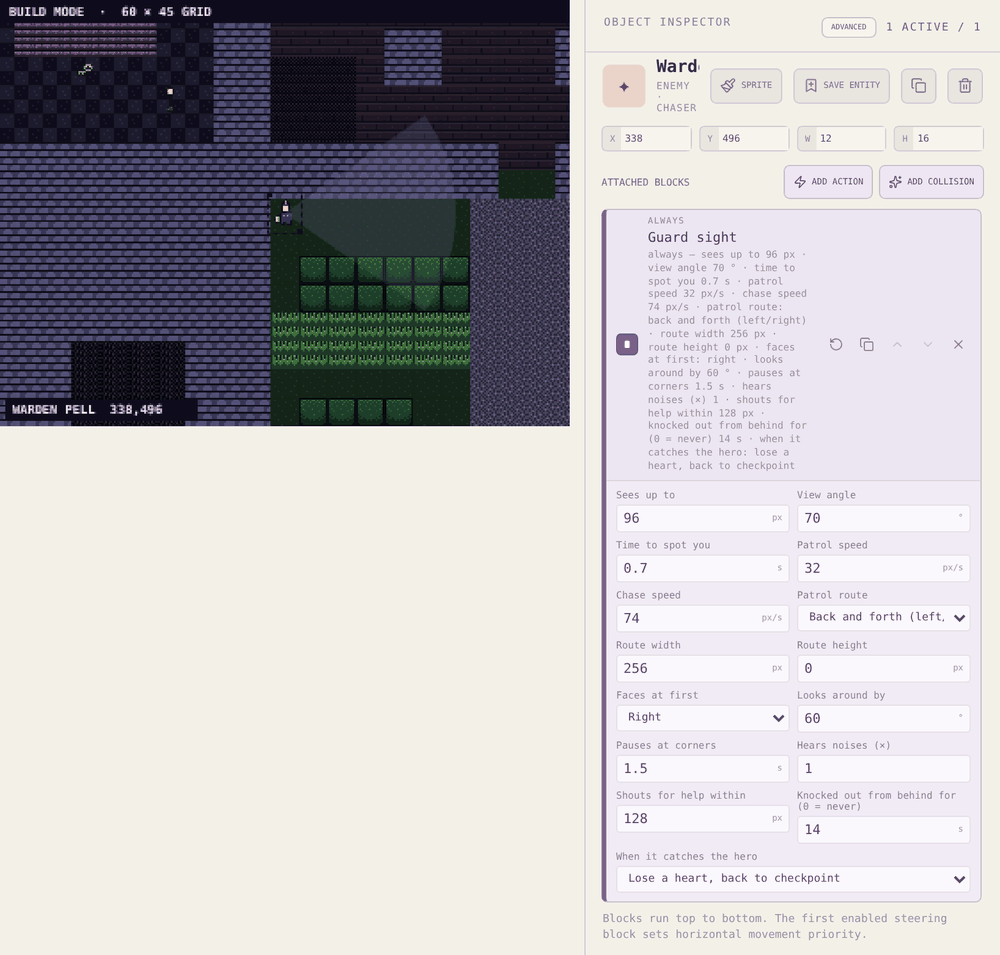

1. Place a **Prowler**. Name **Warden Pell**, at `338, 496, 12 × 16`.
2. Click **×** on all four starter blocks: **Gravity**, **Chase**, **Stompable**, **Touch damage**. Wardens catch Moth with their eyes instead.
3. **ADD ACTION** > search "Guard" > **Guard sight**. Set every setting:

   | Setting                                 | Value                            |
   | --------------------------------------- | -------------------------------- |
   | Sees up to                              | 96                               |
   | View angle                              | 70                               |
   | Time to spot you                        | 0.7                              |
   | Patrol speed                            | 32                               |
   | Chase speed                             | 74                               |
   | Patrol route                            | Back and forth (left/right)      |
   | Route width                             | 256                              |
   | Route height                            | 0                                |
   | Faces at first                          | Right                            |
   | Looks around by                         | 60                               |
   | Pauses at corners                       | 1.5                              |
   | Hears noises (×)                        | 1                                |
   | Shouts for help within                  | 128                              |
   | Knocked out from behind for (0 = never) | 14                               |
   | When it catches the hero                | Lose a heart, back to checkpoint |

4. **SPRITE** (16 × 16): **IDLE** import `warden-pell/idle.png`; **+ STATE** `move`, import `warden-pell/move.png`, **FRAME TIME = 0.18**; **+ STATE** `out`, import `warden-pell/out.png` (lying down, used while knocked out), **FRAME TIME = 0.18**. **SAVE SPRITE**.

A route starts where the warden stands: **Back and forth** walks Route width to the right and back; **Loop around a rectangle** walks a Route width × Route height rectangle clockwise from the warden's spot; **Stand guard and look around** stays put and turns by **Looks around by**.

#### 6.2 The other wardens

For each row: select **Warden Pell**, press **Ctrl+D**, type the name and x, y, then change the Guard sight settings in the last column. Everything else stays as Pell's.

| Warden           | x, y     | Change in Guard sight                                                                                               |
| ---------------- | -------- | ------------------------------------------------------------------------------------------------------------------- |
| Warden Hobb      | 754, 496 | Patrol speed 28, Patrol route Loop around a rectangle, Route width 160, Route height 128, Looks around 50, Pauses 1 |
| Warden Quill     | 354, 272 | Patrol speed 30, Loop around a rectangle, Route width 176, Route height 160, Looks around 50, Pauses 0.75           |
| Warden Mott      | 466, 336 | Sees up to 88, Stand guard and look around, Route width 0, Faces Up, Looks around 70, Pauses 1                      |
| Reserve warden A | 578, 256 | Sees up to 112, Chase speed 84, Stand guard and look around, Route width 0, Faces Down, Looks around 30, Pauses 1   |
| Reserve warden B | 594, 272 | Same as Reserve warden A (copy A instead of Pell)                                                                   |
| Warden Ivo       | 658, 176 | Route width 112, Looks around 70, Pauses 2                                                                          |
| Warden Fenn      | 674, 256 | Patrol speed 30, Loop around a rectangle, Route width 240, Route height 176, Looks around 50, Pauses 1              |
| Cook Brindle     | 34, 352  | Sees up to 88, Route width 240, Looks around 40, Pauses 1.25                                                        |
| Steward Ravel    | 514, 112 | Sees up to 104, Stand guard and look around, Route width 0, Faces Left, Looks around 70, Pauses 1                   |
| Warden Tull      | 34, 176  | Route width 192, Looks around 50, Pauses 1                                                                          |

These are the checks for some of them:

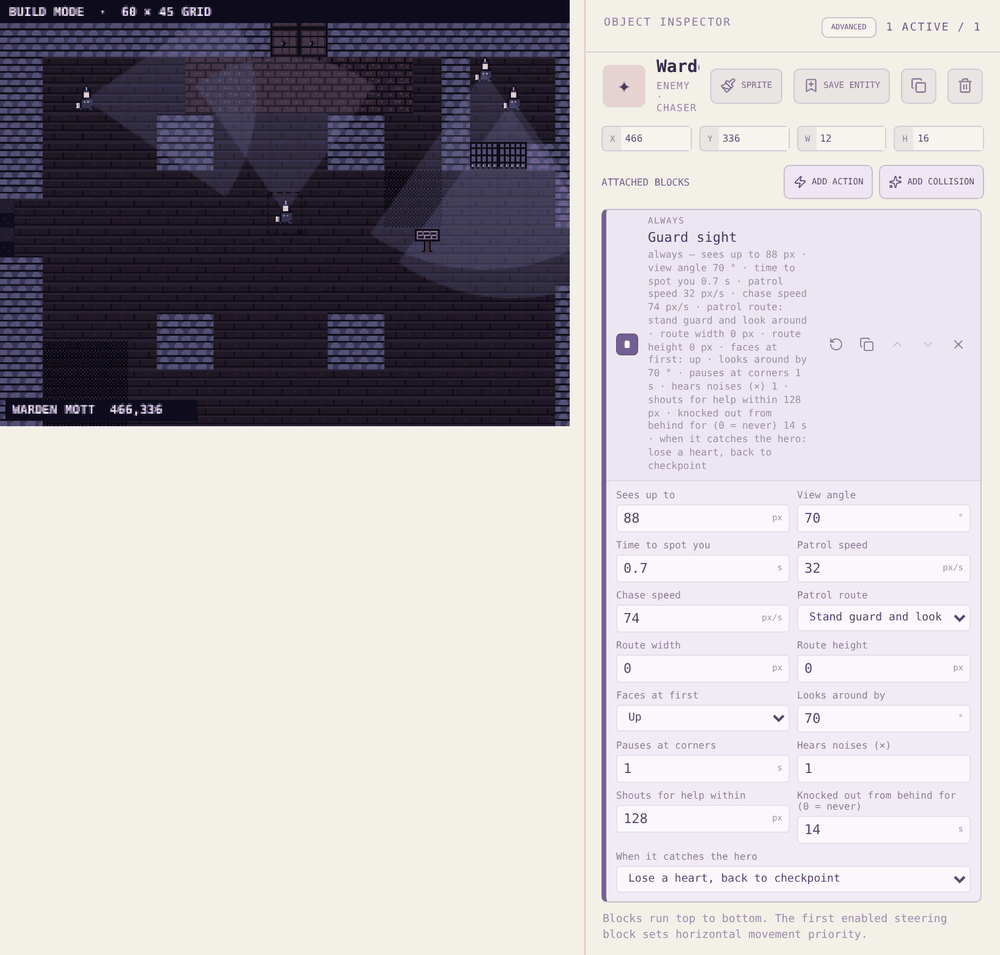

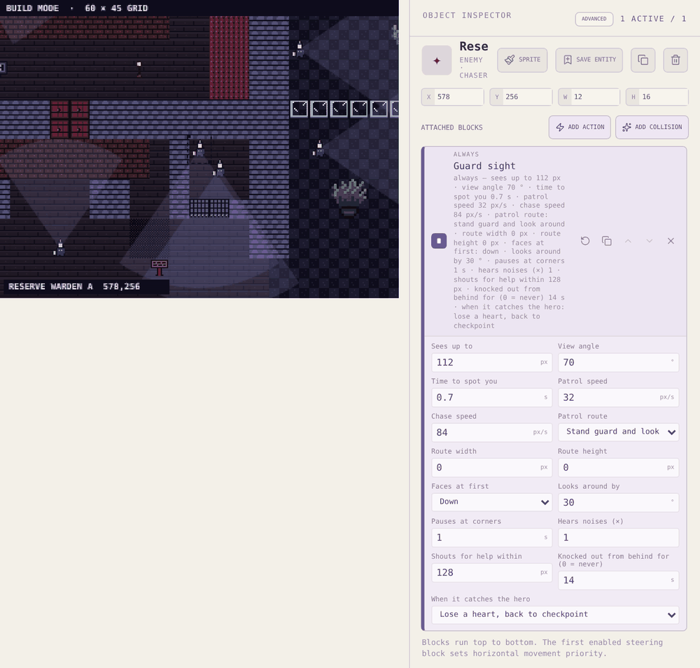

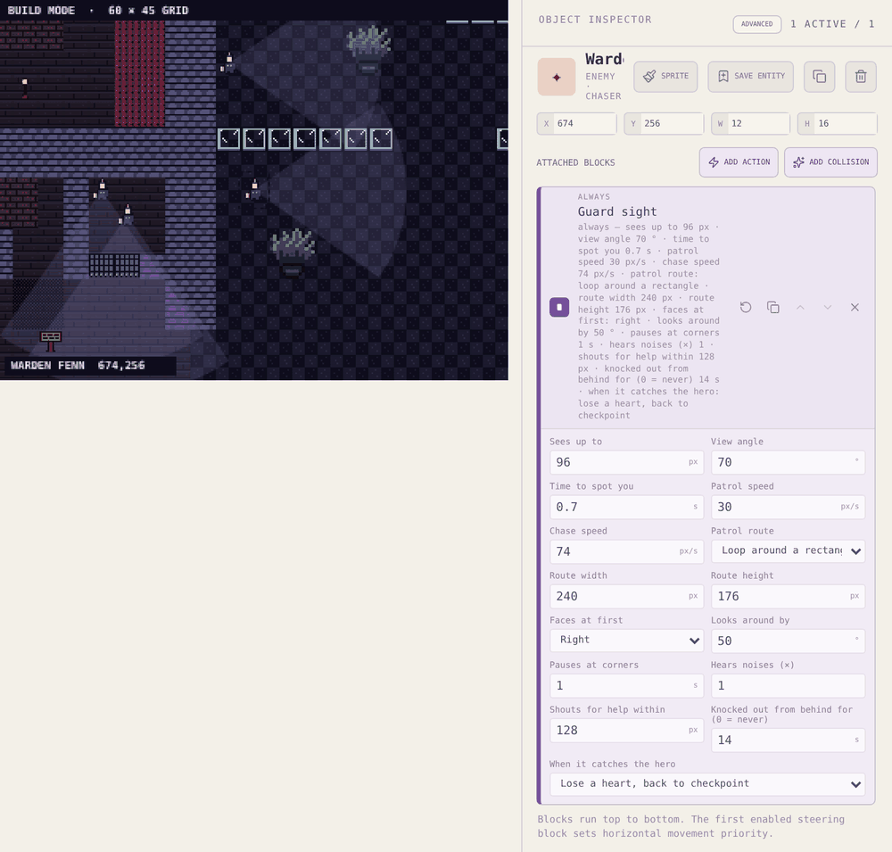

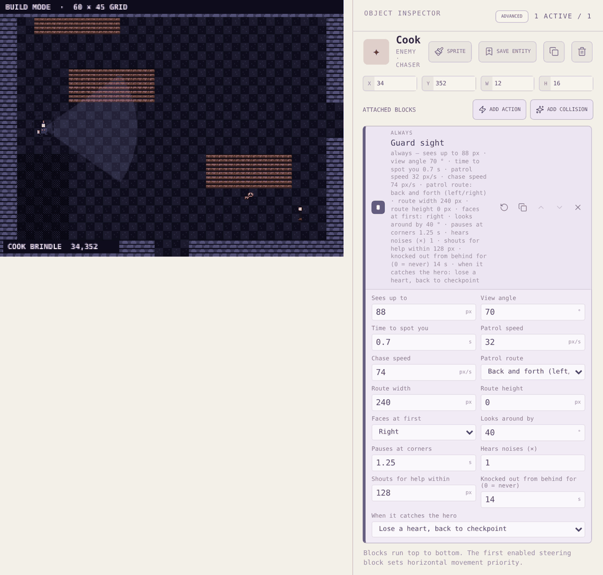

The others (Hobb, Quill, Ivo, Ravel, Tull) look the same with their own numbers. Playtest to see the cones: each warden draws its sight cone while the game runs.

---

### Part 7: Front garden, east lawn and the barracks

#### Garden lamp (checkpoint)

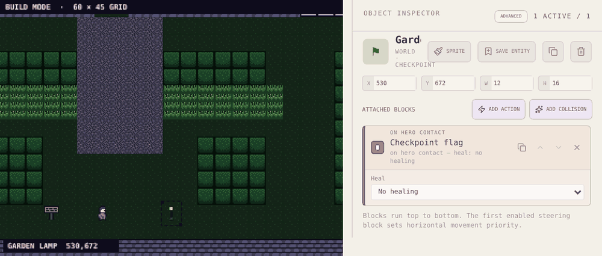

1. Place a **Checkpoint**. Name **Garden lamp**, at `530, 672, 12 × 16`. Keep **Checkpoint flag**. Lamps are where a caught Moth goes back to.
2. **SPRITE** > import `garden-lamp/idle.png` > **SAVE SPRITE**.

#### Moth's note

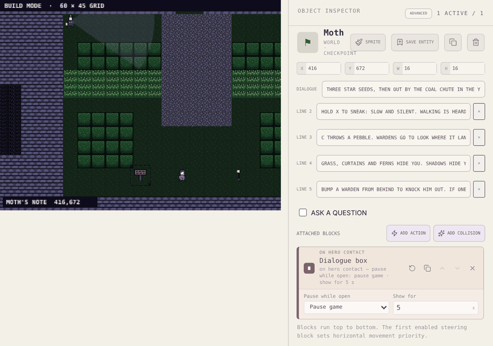

1. Place a **Checkpoint**. Name **Moth's note**, at `416, 672, 16 × 16`. **×** on **Checkpoint flag**.
2. **ADD COLLISION** > search "Dialogue" > **Dialogue box**: `Pause while open = Pause game`, `Show for = 5`.
3. Type the lines ([§12](EDITOR-BASICS.md#12-dialogue-text)): the first in **DIALOGUE**, then **+ LINE** for each next one:
   1. `THREE STAR SEEDS, THEN OUT BY THE COAL CHUTE IN THE YARD. THE CHUTE IS PAST THE KITCHEN.`
   2. `HOLD X TO SNEAK: SLOW AND SILENT. WALKING IS HEARD, GRAVEL ALWAYS CRUNCHES.`
   3. `C THROWS A PEBBLE. WARDENS GO TO LOOK WHERE IT LANDS. YOU HAVE EIGHT.`
   4. `GRASS, CURTAINS AND FERNS HIDE YOU. SHADOWS HIDE YOU IF YOU KEEP STILL.`
   5. `BUMP A WARDEN FROM BEHIND TO KNOCK HIM OUT. IF ONE CATCHES YOU, BACK TO THE LAST LAMP.`
4. **SPRITE** > import `moth-s-note/idle.png` > **SAVE SPRITE**.

#### Night apple

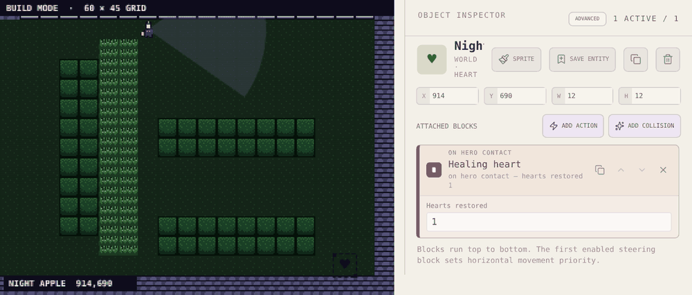

1. Place a **Heart**. Name **Night apple**, at `914, 690, 12 × 12`. Keep **Healing heart**.

#### Barracks portcullis

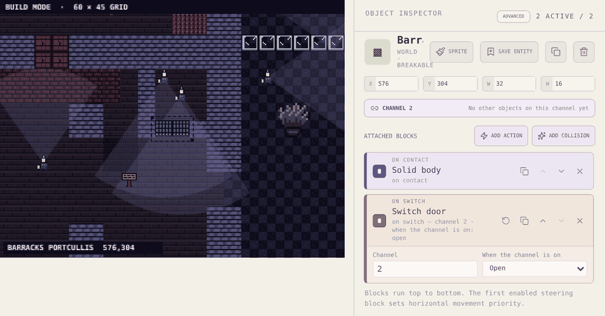

1. Place a **Cracked wall**. Name **Barracks portcullis**, at `576, 304, 32 × 16`.
2. Keep **Solid body**, click **×** on **Dash breakable**.
3. **ADD COLLISION** > search "Switch door" > **Switch door**: `Channel = 2`, `When the channel is on = Open`. The alarm turns channel 2 on while it rings, which lifts the portcullis and lets the two reserve wardens out.
4. **SPRITE** > import `barracks-portcullis/idle.png` (iron bars), **Repeat as tiles** > **SAVE SPRITE**.

#### Barracks notice

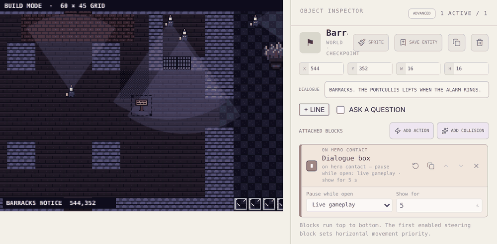

1. Select **Moth's note**, **Ctrl+D**. Name **Barracks notice**, at `544, 352`.
2. Set `Pause while open = Live gameplay`. Remove lines 2 to 5 with their **×** and change the text to `BARRACKS. THE PORTCULLIS LIFTS WHEN THE ALARM RINGS.`

---

### Part 8: The glasshouse (seed 1)

#### Glasshouse eye (a camera that calls wardens)

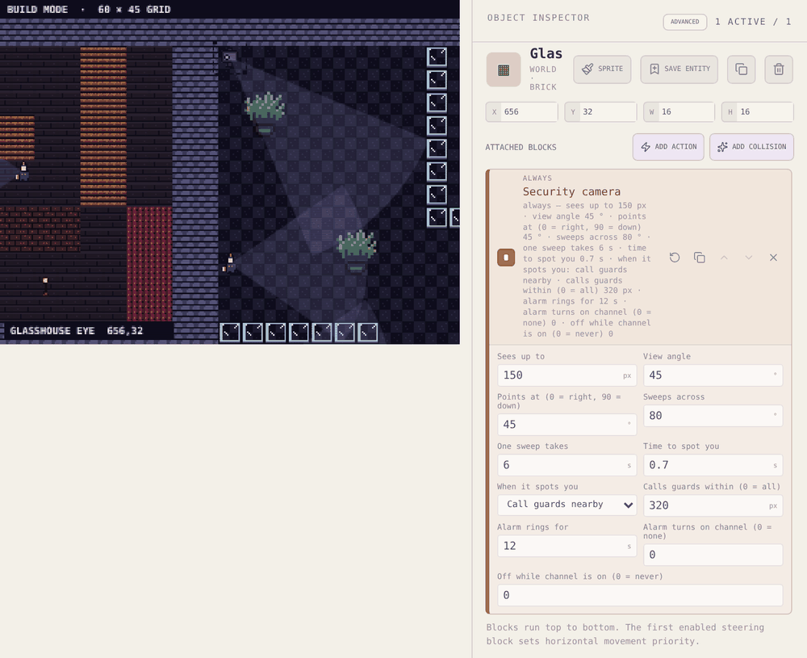

1. Place a **Brick**. Name **Glasshouse eye**, at `656, 32, 16 × 16`.
2. **×** on **Solid body**.
3. **ADD COLLISION** > search "Security" > **Security camera**:

   | Setting                          | Value              |
   | -------------------------------- | ------------------ |
   | Sees up to                       | 150                |
   | View angle                       | 45                 |
   | Points at (0 = right, 90 = down) | 45 (down-right)    |
   | Sweeps across                    | 80                 |
   | One sweep takes                  | 6                  |
   | Time to spot you                 | 0.7                |
   | When it spots you                | Call guards nearby |
   | Calls guards within (0 = all)    | 320                |

   It does not ring the alarm; it sends the wardens to where it saw Moth.

4. **SPRITE** > import `glasshouse-eye/idle.png` > **SAVE SPRITE**.

#### Star seed: glasshouse

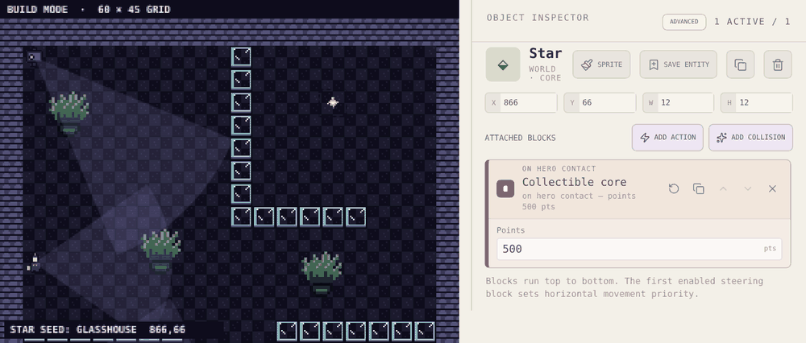

1. Place a **Core**. Name **Star seed: glasshouse**, at `866, 66, 12 × 12`.
2. Keep **Collectible core** and set `Points = 500`.
3. **SPRITE** > import `star-seed-glasshouse/idle.png` (two glowing frames), **FRAME TIME = 0.4** > **SAVE SPRITE**.

> **Check:** walk into the glasshouse. Wardens Ivo and Fenn can see Moth through the glass; the camera's cone sweeps and, if it spots Moth, wardens walk over to look.

---

### Part 9: Kitchen, the key and the study (seed 2)

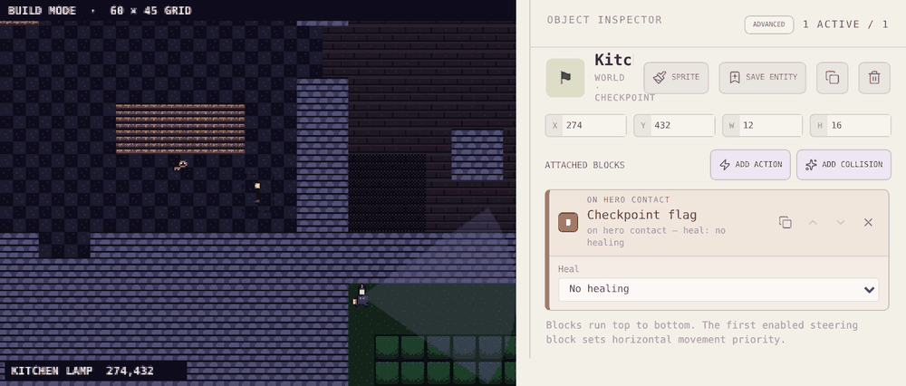

1. Copy **Garden lamp**: **Kitchen lamp** at `274, 432`.

#### Brass key

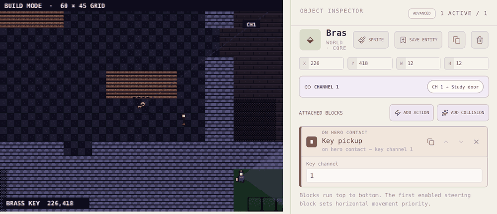

1. Place a **Core**. Name **Brass key**, at `226, 418, 12 × 12`.
2. **×** on **Collectible core**. It must not count as a seed, or the chute would need it too.
3. **ADD COLLISION** > search "Key pickup" > **Key pickup**: `Key channel = 1`.
4. **SPRITE** > import `brass-key/idle.png` > **SAVE SPRITE**.

#### Study door

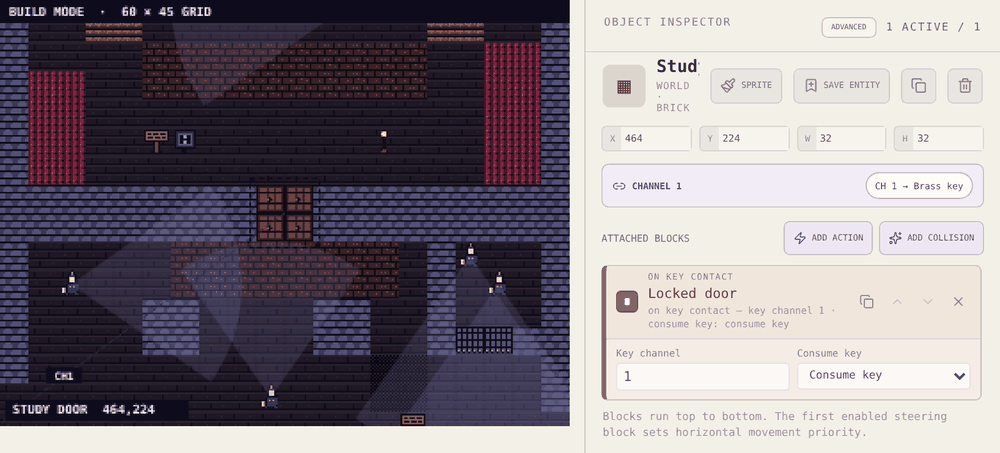

1. Place a **Brick**. Name **Study door**, at `464, 224, 32 × 32`, in the gap in the wall.
2. **×** on **Solid body**.
3. **ADD COLLISION** > search "Locked" > **Locked door**: `Key channel = 1`, `Consume key = Consume key`.
4. **SPRITE** > import `study-door/idle.png`, **Repeat as tiles** > **SAVE SPRITE**.

#### Study lamp and the second seed

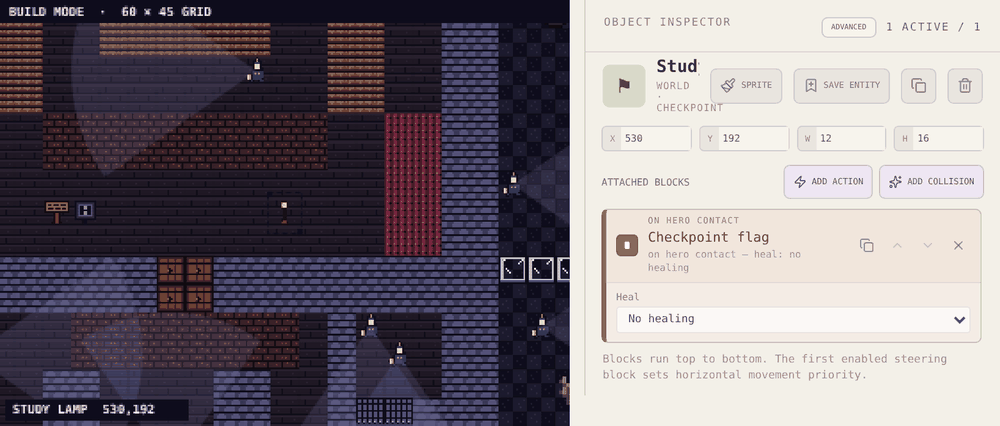

1. Copy **Garden lamp**: **Study lamp** at `530, 192`.

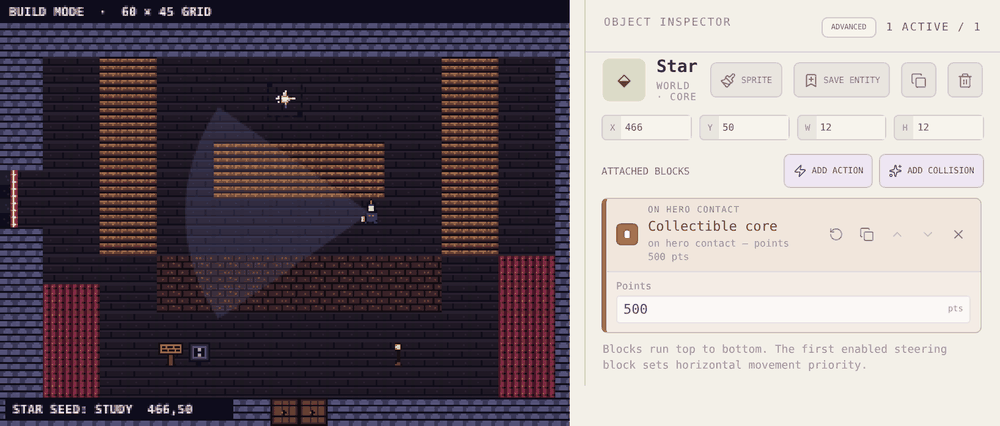

2. Copy **Star seed: glasshouse**: **Star seed: study** at `466, 50`.

#### The fuse box (a rule that turns a camera off)

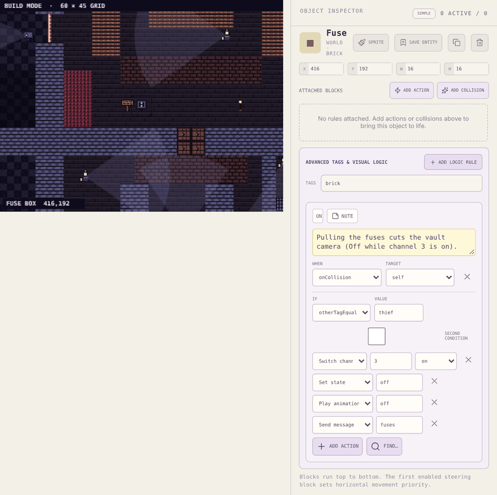

1. Place a **Brick**. Name **Fuse box**, at `416, 192, 16 × 16`.
2. **×** on **Solid body**. It has no blocks at all; a rule does everything.
3. **SPRITE**: **IDLE** import `fuse-box/idle.png` (fuses in); **+ STATE** `off`, import `fuse-box/off.png` (fuses pulled), **FRAME TIME = 0.2**. **SAVE SPRITE**.
4. The rule ([§14](EDITOR-BASICS.md#14-rules-when--do-)):
   1. **ADVANCED** > **ADD LOGIC RULE**.
   2. **WHEN** = `onCollision`, **TARGET** = `self`.
   3. **IF** = `otherTagEquals`, and type `thief` in the **VALUE** box.
   4. First action: **Switch channel**, channel `3`, `on`.
   5. **ADD ACTION**: **Set state**, type `off`.
   6. **ADD ACTION**: **Play animation**, type `off`.
   7. **ADD ACTION**: **Send message**, type `fuses`.
   8. Click **SIMPLE**.

   The `otherTagEquals thief` condition matters: without it, the floor under the fuse box touches it at the start and pulls the fuses before Moth gets there.

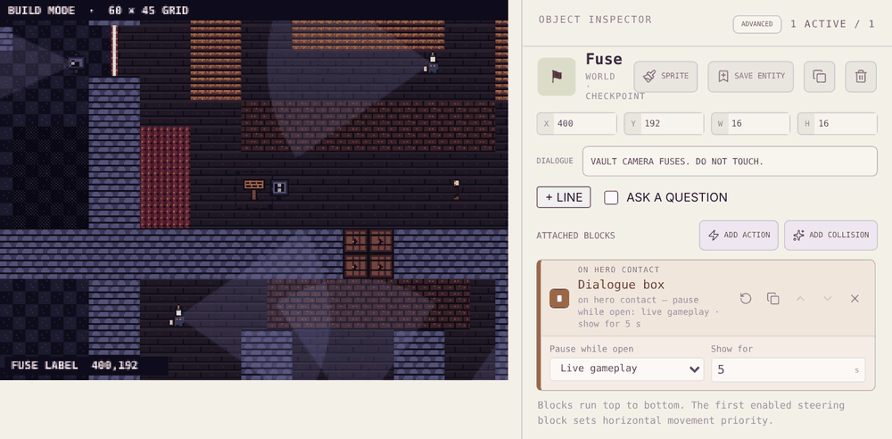

5. Copy **Barracks notice**: **Fuse label** at `400, 192`, text `VAULT CAMERA FUSES. DO NOT TOUCH.`

> **Check:** take the key from behind the kitchen tables, open the study door, avoid Ravel's gaze and touch the fuse box: it changes to its "off" picture.

---

### Part 10: The vault (seed 3)

#### Vault laser

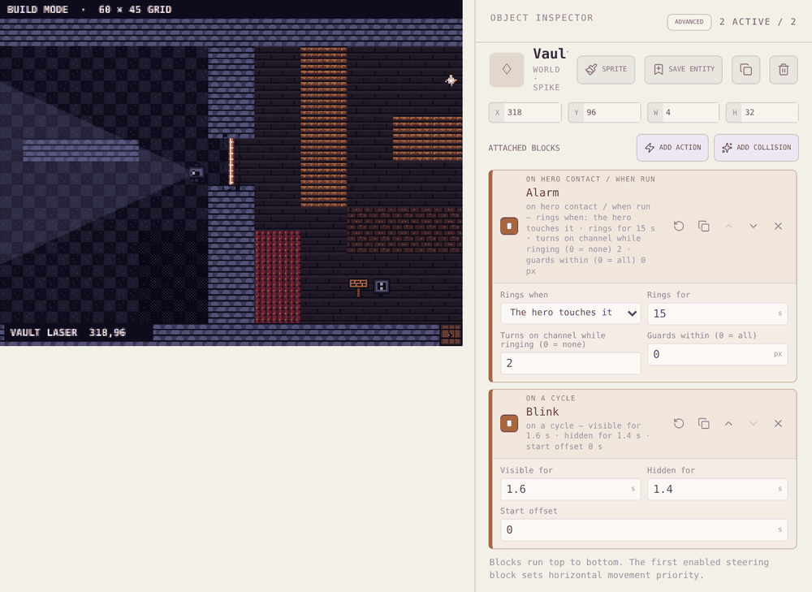

1. Place a **Spikes**. Name **Vault laser**, at `318, 96, 4 × 32`, across the vault doorway.
2. **×** on **Hazard**.
3. **ADD COLLISION** > search "Alarm" > **Alarm**: `Rings when = The hero touches it`, `Rings for = 15`, `Turns on channel while ringing (0 = none) = 2`, `Guards within (0 = all) = 0`.
4. **ADD COLLISION** > search "Blink" > **Blink**: `Visible for = 1.6`, `Hidden for = 1.4`, `Start offset = 0`. The beam blinks, so the player can time a dash through.
5. **SPRITE** > import `vault-laser/idle.png` (a red beam, two flickering frames), **FRAME TIME = 0.1**, **Repeat as tiles** > **SAVE SPRITE**.

#### Vault eye (a camera wired to the fuses)

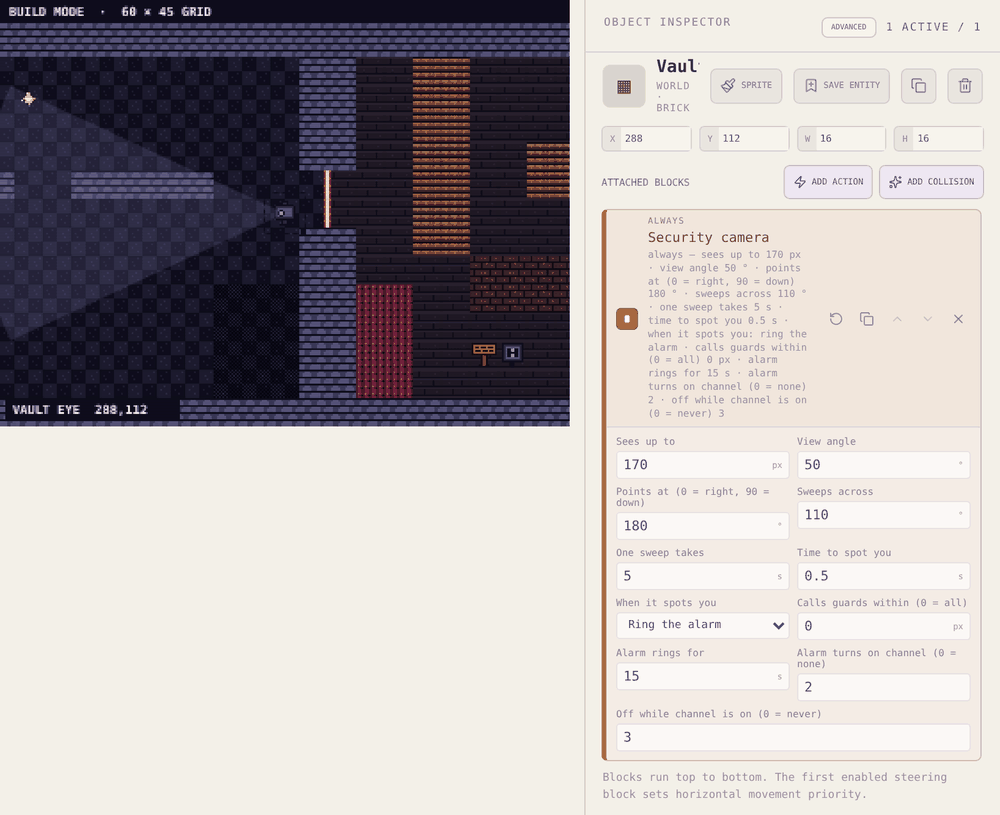

1. Copy **Glasshouse eye**: **Vault eye** at `288, 112`.
2. Change its Security camera to:

   | Setting                             | Value          |
   | ----------------------------------- | -------------- |
   | Sees up to                          | 170            |
   | View angle                          | 50             |
   | Points at (0 = right, 90 = down)    | 180 (left)     |
   | Sweeps across                       | 110            |
   | One sweep takes                     | 5              |
   | Time to spot you                    | 0.5            |
   | When it spots you                   | Ring the alarm |
   | Calls guards within (0 = all)       | 0              |
   | Alarm rings for                     | 15             |
   | Alarm turns on channel (0 = none)   | 2              |
   | Off while channel is on (0 = never) | 3              |

   `Off while channel is on = 3` is the wire to the fuse box: once Moth pulls the fuses, channel 3 is on and this camera goes dark.

#### Warden Tull and the last seed

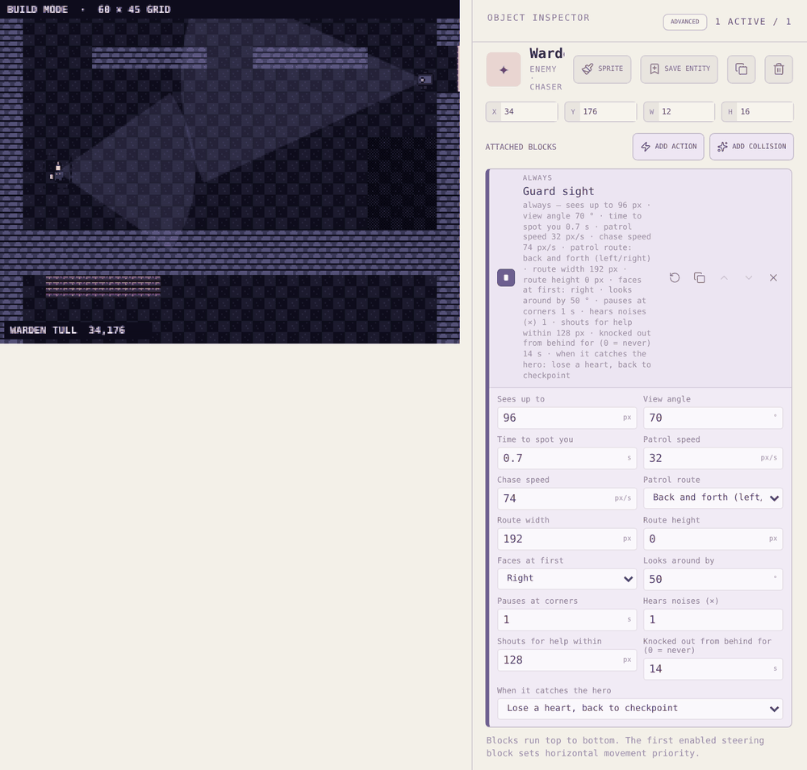

Warden Tull was placed in Part 6.

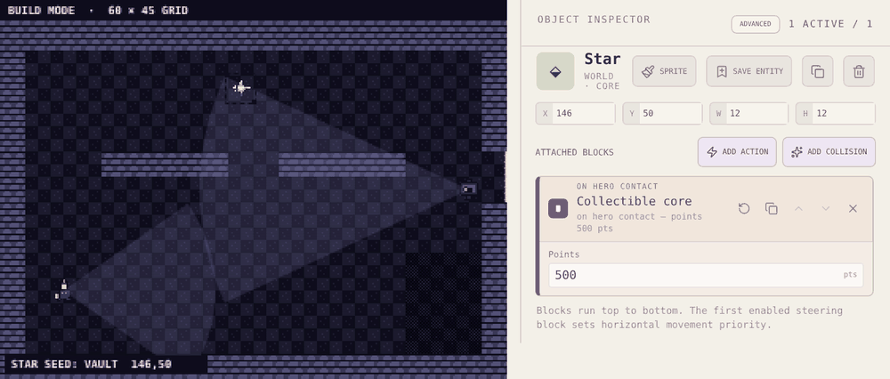

1. Copy a star seed: **Star seed: vault** at `146, 50`.

---

### Part 11: The coal yard (the exit)

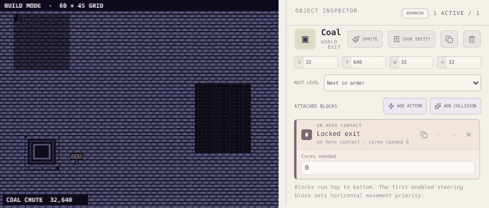

1. Place an **Exit**. Name **Coal chute**, at `32, 640, 32 × 32`. Keep **Locked exit**: it opens only when all three seeds (every Collectible core) are taken.
2. **SPRITE** > import `coal-chute/idle.png` > **SAVE SPRITE**.

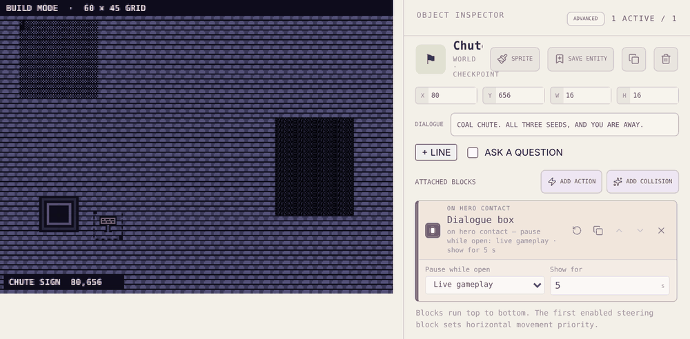

3. Copy **Barracks notice**: **Chute sign** at `80, 656`, text `COAL CHUTE. ALL THREE SEEDS, AND YOU ARE AWAY.`

---

### Part 12: Playtest the whole game

1. Front garden: sneak past Pell using the grass, or throw a pebble (C) to pull him away. Stay off the gravel.
2. Gallery: hide in the shadow, wait for Quill to loop past. Sneak over the creaky boards.
3. Glasshouse: move fern to fern; the camera only calls wardens, it does not raise the alarm. Seed 1.
4. Kitchen: wait for Brindle to turn, take the key from behind the tables.
5. Study: unlock the door, avoid Ravel's gaze, pull the fuses, seed 2.
6. Vault: time the laser, slip past Tull (or knock him out from behind), seed 3. The camera is off if you pulled the fuses.
7. Out through the kitchen to the coal chute.

Trip the laser once on purpose: the screen flashes, the HUD counts down, every warden hurries to the vault and the barracks portcullis opens.

Save with **FILE > Save** when it works.

#### Troubleshooting

| Problem                             | Fix                                                                                        |
| ----------------------------------- | ------------------------------------------------------------------------------------------ |
| Floors cover the walls or the hero  | Floors must be placed first; delete a late floor and rebuild it at the start of a new game |
| Guards see Moth through walls       | Walls must be Solid bodies; only objects tagged glass are see-through                      |
| Guards cannot see through the glass | The glass pieces need the tag glass (ADVANCED > TAGS)                                      |
| Moth is never hidden                | Hiding spots must not be solid, and Moth's middle must be inside the spot                  |
| The fuse box fires at the start     | Its rule needs IF `otherTagEquals` `thief`, and Moth needs the tag thief                   |
| The vault camera never switches off | Vault eye Off while channel is on = 3, and the fuse rule switches channel 3 on             |
| The barracks never open             | The portcullis Switch door must use the same channel the alarm turns on (2)                |
| The chute stays shut                | The brass key must not be a Collectible core; check all three seeds are                    |
| Moth is shoved when hit             | Damage + respawn Knockback = 0                                                             |

---

### Ideas to take it further

- Make lamps react to the alarm: a rule `WHEN onMessage, MESSAGE alarm` on a lamp can **Play animation** (a red glow), and `allclear` puts it back.
- Add a **Time limit** for an "escape before dawn" mode.
- Put a **Noise maker** in a **Timer** on a grandfather clock to pull wardens around on a schedule.
- Hide a **Treasure chest** with a second **Key input** item, like a smoke bomb built from **Invulnerability window** and **Particles**.

---

### Appendix A: house pieces

All are **Brick** with **Solid body**. Glass pieces also carry the tag `glass`.

#### Wall

| Name    | x   | y   | w   | h   |
| ------- | --- | --- | --- | --- |
| Wall 1  | 0   | 0   | 320 | 32  |
| Wall 2  | 320 | 0   | 320 | 32  |
| Wall 3  | 640 | 0   | 320 | 32  |
| Wall 4  | 0   | 32  | 16  | 240 |
| Wall 5  | 304 | 32  | 32  | 64  |
| Wall 6  | 624 | 32  | 32  | 240 |
| Wall 7  | 944 | 32  | 16  | 240 |
| Wall 8  | 64  | 96  | 80  | 16  |
| Wall 9  | 176 | 96  | 80  | 16  |
| Wall 10 | 304 | 128 | 32  | 208 |
| Wall 11 | 16  | 224 | 288 | 32  |
| Wall 12 | 336 | 224 | 128 | 32  |
| Wall 13 | 496 | 224 | 128 | 32  |
| Wall 14 | 560 | 256 | 16  | 64  |
| Wall 15 | 0   | 272 | 16  | 240 |
| Wall 16 | 624 | 272 | 32  | 80  |
| Wall 17 | 944 | 272 | 16  | 240 |
| Wall 18 | 400 | 288 | 32  | 32  |
| Wall 19 | 496 | 288 | 32  | 32  |
| Wall 20 | 608 | 304 | 16  | 16  |
| Wall 21 | 304 | 368 | 32  | 240 |
| Wall 22 | 624 | 384 | 32  | 112 |
| Wall 23 | 400 | 400 | 32  | 32  |
| Wall 24 | 496 | 400 | 32  | 32  |
| Wall 25 | 16  | 464 | 128 | 32  |
| Wall 26 | 176 | 464 | 128 | 32  |
| Wall 27 | 336 | 464 | 128 | 32  |
| Wall 28 | 496 | 464 | 128 | 32  |
| Wall 29 | 0   | 512 | 16  | 208 |
| Wall 30 | 944 | 512 | 16  | 208 |
| Wall 31 | 304 | 608 | 32  | 112 |
| Wall 32 | 16  | 704 | 288 | 16  |
| Wall 33 | 336 | 704 | 320 | 16  |
| Wall 34 | 656 | 704 | 288 | 16  |

#### Furniture

| Name        | x   | y   | w   | h   |
| ----------- | --- | --- | --- | --- |
| Furniture 1 | 368 | 32  | 32  | 112 |
| Furniture 2 | 560 | 32  | 32  | 112 |
| Furniture 3 | 432 | 80  | 96  | 32  |
| Furniture 4 | 32  | 256 | 80  | 16  |
| Furniture 5 | 64  | 304 | 80  | 32  |
| Furniture 6 | 192 | 384 | 80  | 32  |

#### Hedge

| Name    | x   | y   | w   | h   |
| ------- | --- | --- | --- | --- |
| Hedge 1 | 352 | 528 | 96  | 32  |
| Hedge 2 | 528 | 528 | 96  | 32  |
| Hedge 3 | 688 | 528 | 32  | 144 |
| Hedge 4 | 768 | 576 | 128 | 32  |
| Hedge 5 | 352 | 608 | 64  | 64  |
| Hedge 6 | 560 | 608 | 64  | 64  |
| Hedge 7 | 768 | 656 | 128 | 32  |

#### Coal heap

| Name        | x   | y   | w   | h   |
| ----------- | --- | --- | --- | --- |
| Coal heap 1 | 224 | 576 | 64  | 80  |

#### Glass

| Name    | x   | y   | w   | h   |
| ------- | --- | --- | --- | --- |
| Glass 1 | 800 | 32  | 16  | 128 |
| Glass 2 | 816 | 144 | 80  | 16  |
| Glass 3 | 656 | 224 | 112 | 16  |
| Glass 4 | 832 | 224 | 112 | 16  |
| Glass 5 | 656 | 464 | 288 | 32  |

